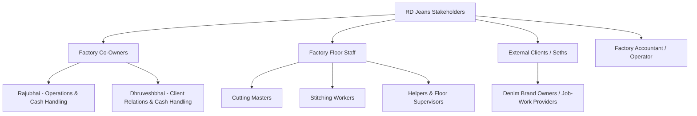
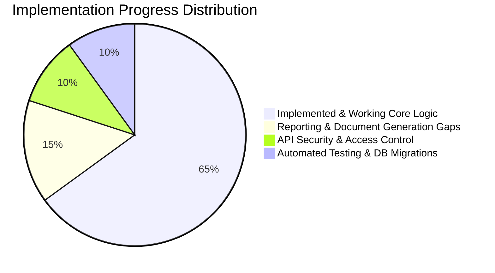

# RD Jeans Factory Management System - Project Overview

## 1. Executive Summary

The **RD Jeans Factory Management System** is a purpose-built, full-stack Enterprise Resource Planning (ERP) web application tailored specifically for denim manufacturing and garment production factories. Operating in the industrial garment manufacturing hub, RD Jeans coordinates raw fabric procurement, job-work processing for external clothing brand owners ("Seths"), precision piece-cutting operations, factory floor labor management, worker salary advances ("Upad"), operational overheads, and dual-owner equity accounting.

The application streamlines daily factory floor and office operations into a unified web interface, replacing error-prone manual paper registers and fragmented bookkeeping with an automated, synchronized operational and financial ledger.

---

## 2. Business Problem & Operational Context

Garment manufacturing units in the denim sector operate on narrow margins and high-throughput volume. In standard operations, factories face severe operational challenges:

1. **Fabric Roll Wastage and Meter Shrinkage**: Denim fabric is purchased or received in large rolls (measured in meters). Without real-time tracking, factories suffer unaccounted fabric losses between roll inward, layer spreading, and cutting piece yield.
2. **Piece-Cutting Discrepancies**: Each cutting lot requires specific cloth dimensions (*pana*), layer counts, and average meters per piece. Manual record-keeping leads to mismatches between pieces produced and fabric meters consumed.
3. **Weekly Worker Advances ("Upad")**: Factory floor workers (stitching workers, cutting masters, helpers) frequently take cash advances against their upcoming salaries. Manually tracking multiple cash advances across tens of workers often leads to salary settlement disputes at month-end.
4. **Decentralized Cash Accounting**: Factory cash flow is managed directly out of the factory cash drawer by the two co-owners (**Rajubhai** and **Dhruveshbhai**). Without automated dual-entry transaction logging, cash balances diverge, and expense categorization is lost.
5. **Client ("Seth") Material and Payment Tracking**: Fabric job-workers ("Seths") provide rolls for cutting and stitching, requiring continuous tracking of client-specific roll balances, piece yields, and outstanding job-work payments.

---

## 3. Project Objectives & Expected Outcomes

| Objective | Target Outcome | Business Metric |
| :--- | :--- | :--- |
| **Centralized Labor Management** | Single dashboard for worker registry, daily status, wage tiers, and advance balance tracking. | 100% elimination of advance calculation errors at month-end. |
| **Precision Roll Tracking** | Real-time roll status tracking (`Available` $\rightarrow$ `Partially Used` $\rightarrow$ `Completed`) with meter balance deduction on every cutting lot entry. | Fabric shrinkage and wastage visibility down to individual rolls and cutting lots. |
| **Automated Cashbook Sync** | Dual-write transactional sync: every salary payout, upad issuance, client payment, and vendor expense automatically updates the central cashbook ledger. | Real-time, passbook-accurate running cash balance without manual reconciliation. |
| **Partner Accountability** | Transparent tracking of funds handled by Rajubhai vs. Dhruveshbhai, preventing financial opacity between co-owners. | Real-time per-partner net cash position. |
| **Exportable Business Intelligence** | Periodic generation of ledger summaries, salary sheets, cutting summaries, and fabric registers. | Instant export of audit-ready operational and financial data. |

---

## 4. Target Users & Stakeholders

* **Factory Co-Owners (Rajubhai & Dhruveshbhai)**: Primary decision-makers. They issue worker advances, receive payments from clients, approve factory expenses, and monitor the overall cash balance and partner ledgers.
* **Factory Accountant / System Administrator**: Operates the application, logs daily cutting lots, records roll deliveries, enters expense receipts, generates monthly salary sheets, and exports compliance reports.
* **Factory Workers (Indirect Stakeholders)**: 40+ factory workers categorized across Stitching, Cutting, Helpers, Indoor Staff, Outdoor Staff, and Supervisors whose attendance, advance balance, and monthly wages are governed by the system.
* **Seths / Clients (External Stakeholders)**: External denim merchants who supply rolls to RD Jeans for cutting and manufacturing.

---

## 5. Scope of the System

### 5.1 In-Scope Features (Current & Near-Term)
* **Authentication**: Credentials validation, session management, and route interception.
* **Dashboard**: Factory KPI cards (active workers, monthly wage bill, total upad issued, active fabric rolls, pieces cut, net cash balance).
* **Employee Management**: Worker directory, role classification, joining date, active/inactive status toggle.
* **Upad Management**: Date-stamped advance issuance, payment method tagging, partner tracking, employee balance aggregation.
* **Salary Management**: Monthly wage calculation, partial/full payout tracking, remaining balance calculation, auto-deduction sync.
* **Roll Inventory**: Denim roll registry, short numbers, fabric types, received meters, used meters, and real-time remaining meter calculation.
* **Cutting Lot Operations**: Lot number, roll linkage, meter deduction, layer information, piece count yield, pana, average meter per piece, sort numbers.
* **Seth Management**: Client directory, roll inventory segregation per client, payment logging.
* **Income & Expense Management**: Categorized money inflows and operational expenditures (rent, electricity, transport, materials).
* **Cashbook Ledger**: Chronological passbook view, running cash balance recalculation, multi-parameter filtering.
* **Partner Ledger**: Inward/outward transaction segregation per partner (`Rajubhai` vs `Dhruveshbhai`).
* **Reporting Center**: Category-based and date-filtered exports.

### 5.2 Out-of-Scope (Future Phases)
* Biometric hardware integration for automated time-card attendance.
* Automated piece-rate barcode scanning at cutting and stitching tables.
* Multi-branch / multi-warehouse inventory routing.
* Direct banking API payment integration (NEFT/RTGS automation).

---

## 6. Current Implementation Baseline (~65% Completion)

The system currently stands at approximately **65% core logic completion**. The system architecture has undergone an evolutionary consolidation:
* **Initial Architecture**: Decoupled Python FastAPI backend (`backend/app/*`) communicating with a Next.js client.
* **Current Architecture**: Fully unified full-stack Next.js application with TypeScript route handlers (`app/api/*`), service controllers (`lib/services/*`), direct PostgreSQL pooling (`lib/db.ts`), and client-side reactive state management (`lib/employee-store.ts`).

### Current Status Summary

---

## 7. Assumptions, Constraints & Dependencies

### Assumptions
* A single factory installation serves both factory co-owners on shared or individual mobile/desktop devices.
* Standard operating currency is Indian Rupee (INR / ₹).
* Default operational month follows the standard Gregorian calendar month.

### Technical Constraints
* **Node.js Environment**: Node.js v20+ with React 19 and Next.js 16 App Router.
* **Database**: PostgreSQL 15+ running locally or on managed cloud providers (e.g., Neon, Supabase, Railway).
* **Network**: Offline client fallback mechanism (`FALLBACK_STORE` in `lib/employee-store.ts`) handles intermittent factory internet connectivity.

### Dependencies
* **Core Libraries**: `pg` (PostgreSQL client pool), `jsonwebtoken`, `bcryptjs`, `lucide-react`, `tailwindcss`, `clsx`, `tailwind-merge`.
* **Environment Configuration**: `DATABASE_URL`, `JWT_SECRET`, `SECRET_KEY`, `ACCESS_TOKEN_EXPIRE_MINUTES`.
