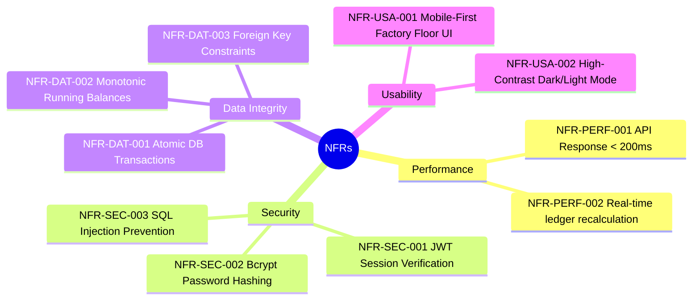
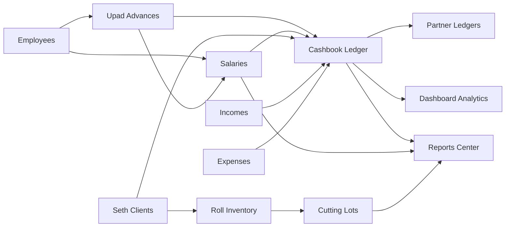

# RD Jeans Factory Management System - Business Requirements Document (BRD)

## 1. Introduction & Requirement Traceability

This document formalizes the complete business requirements for the RD Jeans Factory Management System. Every requirement is assigned a unique, immutable identifier to ensure end-to-end traceability across architecture, implementation, test cases, and the development roadmap.

### Requirement Classification Convention
* `REQ-AUTH-xxx`: Authentication and Session Management
* `REQ-DSH-xxx`: Factory Dashboard & Real-Time Metrics
* `REQ-EMP-xxx`: Employee Registry & Role Administration
* `REQ-UPD-xxx`: Upad (Salary Advances) Management
* `REQ-SAL-xxx`: Monthly Salary Settlement & Wage Accounting
* `REQ-STH-xxx`: Seth (Client / Job-Work Merchant) Operations
* `REQ-ROL-xxx`: Denim Fabric Roll Inventory Tracking
* `REQ-CUT-xxx`: Cutting Lot Production & Yield Accounting
* `REQ-INC-xxx`: Factory Inflow & Client Payment Receipts
* `REQ-EXP-xxx`: Factory Outflow & Operational Expenditures
* `REQ-CSH-xxx`: Central Passbook & Cashbook Ledger
* `REQ-PRT-xxx`: Partner Accounts & Owner Inflow/Outflow Segregation
* `REQ-REP-xxx`: Reporting, Summaries & Document Exports
* `NFR-xxx`: Non-Functional Quality Attributes

---

## 2. Functional Requirements Catalog

### 2.1 Authentication & Security (AUTH)

| ID | Title | Business Requirement Description | Priority |
| :--- | :--- | :--- | :--- |
| **REQ-AUTH-001** | Credential Validation | The system must authenticate users via unique username and password. Unauthenticated users must be prevented from accessing operational pages. | Critical |
| **REQ-AUTH-002** | Session Persistence | Upon successful login, the system must issue a signed JSON Web Token (JWT) and establish a browser cookie (`rd_user`) valid for 24 hours. | High |
| **REQ-AUTH-003** | Route Protection | Client-side routing must inspect credentials on all navigation events; requests lacking a valid session must redirect automatically to `/login`. | Critical |
| **REQ-AUTH-004** | Secure Logout | The system must allow users to log out explicitly, invalidating cookies and local state storage. | Medium |
| **REQ-AUTH-005** | API Route Authorization Guard | All Next.js `/api/*` endpoints must validate the Bearer JWT token before executing database reads or mutations. | Critical (Gap) |

### 2.2 Factory Dashboard & Analytics (DSH)

| ID | Title | Business Requirement Description | Priority |
| :--- | :--- | :--- | :--- |
| **REQ-DSH-001** | Real-Time Cash Position | The dashboard must display current factory liquid cash balance calculated dynamically from the Cashbook ledger. | High |
| **REQ-DSH-002** | Today & Monthly Cash Flow | The dashboard must display cash in vs. cash out totals for the current date and current calendar month. | High |
| **REQ-DSH-003** | Operational KPI Summary | The system must calculate and aggregate: Total Active Employees, Total Monthly Salary liability, Total Outstanding Upad, Active Fabric Rolls, Total Cutting Pieces, and Monthly Revenue vs. Expense. | High |
| **REQ-DSH-004** | Recent Activity Stream | The system must display the 10 most recent factory financial transactions from the central ledger with date, entity name, type, and amount. | Medium |
| **REQ-DSH-005** | Quick Action Navigation | Direct one-click routing to all primary modules from the central landing page. | Medium |

### 2.3 Employee Management (EMP)

| ID | Title | Business Requirement Description | Priority |
| :--- | :--- | :--- | :--- |
| **REQ-EMP-001** | Worker Registry | Maintain a complete registry of factory workers including Full Name, Role, Joining Date, and Active/Inactive Status. | High |
| **REQ-EMP-002** | Role Classification | Support standard textile factory roles: `Stitching Worker`, `Cutting Worker`, `Helper`, `Indoor Staff`, `Outdoor Staff`, `Supervisor`. | High |
| **REQ-EMP-003** | Worker Profile & History | Provide a detailed profile view displaying total historical advances (upad), salary payment records, and net active balances. | High |
| **REQ-EMP-004** | Worker Status Deactivation | Allow marking workers as inactive without deleting historical financial records. | High |

### 2.4 Upad (Advance Payment) Management (UPD)

| ID | Title | Business Requirement Description | Priority |
| :--- | :--- | :--- | :--- |
| **REQ-UPD-001** | Advance Issuance | Log cash advances provided to employees with date, amount, payment method (`Cash`, `GPay`, `Bank Transfer`), handled by partner (`Rajubhai` or `Dhruveshbhai`), and optional notes. | Critical |
| **REQ-UPD-002** | Automatic Cashbook Deduction | When an Upad entry is created, the system must atomically record a corresponding outflow entry in the `cash_book_ledger` with reference module `Upad`. | Critical |
| **REQ-UPD-003** | Upad Modification & Ledger Sync | If an Upad record is modified or deleted, the corresponding `cash_book_ledger` entry must update/delete and trigger recalculation of running cash balances. | Critical |
| **REQ-UPD-004** | Employee Advance Totals | Compute outstanding and cumulative advance totals per employee and per month for deduction at salary payout. | High |

### 2.5 Salary Management (SAL)

| ID | Title | Business Requirement Description | Priority |
| :--- | :--- | :--- | :--- |
| **REQ-SAL-001** | Monthly Salary Ledger | Record monthly salary assessments per employee specifying `salary_month` (1-12), `salary_year`, base `salary_amount`, `paid_amount`, and auto-calculated `remaining_amount`. | Critical |
| **REQ-SAL-002** | Upad Auto-Deduction Warning | When creating or viewing a monthly salary settlement, the system must compute and display all Upad advances taken by the worker in that month to allow exact net payout. | Critical |
| **REQ-SAL-003** | Automatic Cashbook Deduction | On recording a salary payment where `paid_amount > 0`, the system must atomically record an outflow in `cash_book_ledger`. | Critical |
| **REQ-SAL-004** | Partial Payout Tracking | Allow multiple partial salary payouts against a single month's salary with remaining balance carried until full settlement. | High |

### 2.6 Denim Roll Inventory (ROL)

| ID | Title | Business Requirement Description | Priority |
| :--- | :--- | :--- | :--- |
| **REQ-ROL-001** | Fabric Roll Inward | Register inward rolls specifying `seth_id` (Client), entry date, unique `roll_number`, `short_number`, `fabric_type` (e.g. Denim 12oz, Stretch, Cotton Twill), and `received_meter`. | Critical |
| **REQ-ROL-002** | Meter Balance Accounting | Track `received_meter`, `used_meter`, and `remaining_meter` (`received_meter - used_meter`) per roll. | Critical |
| **REQ-ROL-003** | Automated Status Lifecycle | Automatically update roll status: `Available` when untouched, `Partially Used` when $0 < used\_meter < received\_meter$, and `Completed` when $remaining\_meter \le 0$. | Critical |
| **REQ-ROL-004** | Unique Roll & Short Numbering | Enforce uniqueness on `roll_number` and `short_number` to prevent duplicate fabric lot indexing. | High |

### 2.7 Cutting Management (CUT)

| ID | Title | Business Requirement Description | Priority |
| :--- | :--- | :--- | :--- |
| **REQ-CUT-001** | Cutting Lot Registration | Log cutting lot operations with unique `lot_number`, cutting date, linked `roll_id`, `meter_used`, piece count yield (`piece_count`), garment `size` (e.g., 28, 30, 32, 34, 36), and sort number. | Critical |
| **REQ-CUT-002** | Automatic Fabric Deduction | Creating a cutting entry must atomically add `meter_used` to the associated roll's `used_meter` and update the roll's `remaining_meter` and status. | Critical |
| **REQ-CUT-003** | Technical Metrics Logging | Capture specialized denim production parameters: `layer_information` (number of fabric plies laid on cutting table), `pana` (fabric width in inches), and `average` (fabric consumed per finished piece in meters). | High |
| **REQ-CUT-004** | Over-Consumption Prevention | The system must validate that `meter_used` does not exceed the remaining meter balance of the selected roll without an explicit supervisor override. | High (Gap) |

### 2.8 Seth (Client / Merchant) Operations (STH)

| ID | Title | Business Requirement Description | Priority |
| :--- | :--- | :--- | :--- |
| **REQ-STH-001** | Client Directory | Maintain client profiles with `seth_name`, mobile number, factory/office address, and active status. | High |
| **REQ-STH-002** | Client Fabric Allocation | Isolate and display all fabric rolls and cutting operations belonging to a specific Seth. | High |
| **REQ-STH-003** | Seth Payment Receipts | Record payments received from a Seth for job-work with date, amount, payment method (`Cash`, `GPay`, `Bank Transfer`, `Cheque`), and handling partner. | Critical |
| **REQ-STH-004** | Automatic Cashbook Inflow | Any payment received from a Seth must automatically write an inflow entry into `cash_book_ledger`. | Critical |

### 2.9 Income & Expense Management (INC & EXP)

| ID | Title | Business Requirement Description | Priority |
| :--- | :--- | :--- | :--- |
| **REQ-INC-001** | Operational Income Logging | Record factory revenue sources (`Seth Payment`, `Scrap Fabric Sale`, `Other Income`) with source name, date, amount, payment method, and handled by partner. | Critical |
| **REQ-EXP-001** | Categorized Expense Logging | Record factory expenditures under defined categories: `Salary`, `Upad`, `Material`, `Transport`, `Electricity`, `Rent`, `Maintenance`, `Miscellaneous`. | Critical |
| **REQ-INC-002** | Atomic Cashbook Synchronization | Incomes must log an inflow to `cash_book_ledger`; expenses must log an outflow to `cash_book_ledger`. | Critical |

### 2.10 Cashbook & General Ledger (CSH)

| ID | Title | Business Requirement Description | Priority |
| :--- | :--- | :--- | :--- |
| **REQ-CSH-001** | Passbook-Style Chronological Ledger | Provide a consolidated ledger showing date, transaction type, entity/party name, payment method, inflow amount, outflow amount, running cash balance, and handling partner. | Critical |
| **REQ-CSH-002** | Real-Time Running Balance | Maintain a strictly monotonic running balance ($Balance_i = Balance_{i-1} + Inflow_i - Outflow_i$). | Critical |
| **REQ-CSH-003** | Cascade Recalculation | When any transaction is modified or deleted anywhere in the past, all subsequent running balance records must be recomputed in sequence. | Critical |
| **REQ-CSH-004** | Multi-Parameter Filtering | Support real-time search, date range filtering (`date_from`, `date_to`), transaction type filter, and payment method filter. | High |

### 2.11 Partner Accounts (PRT)

| ID | Title | Business Requirement Description | Priority |
| :--- | :--- | :--- | :--- |
| **REQ-PRT-001** | Partner Attribution | Every cash-moving transaction must record the handling partner (`Rajubhai` or `Dhruveshbhai`). | Critical |
| **REQ-PRT-002** | Isolated Partner Summary | Provide an account summary showing total cash collected, total expenses disbursed, and current net cash held per partner. | High |
| **REQ-PRT-003** | Partner Passbook View | Filter the cashbook passbook specifically for Rajubhai, Dhruveshbhai, or consolidated factory view. | High |

### 2.12 Reporting Center (REP)

| ID | Title | Business Requirement Description | Priority |
| :--- | :--- | :--- | :--- |
| **REQ-REP-001** | Multi-Category Reporting | Support generating reports across all 11 business categories: Employees, Salary, Upad, Seths, Fabric Stock, Rolls, Cutting, Income, Expenses, Cashbook, Partners, and Factory Summary. | High |
| **REQ-REP-002** | Structured Date Range Filtering | Filter any report by custom start date and end date or standard presets (current month, last month, custom year). | High |
| **REQ-REP-003** | Excel (.xlsx) Binary Export | Export formatted spreadsheets containing company headers, tabular columns, formulaic totals, and professional styling. | High (Gap) |
| **REQ-REP-004** | PDF (.pdf) Document Export | Generate clean, print-ready PDF reports with headers, page numbers, and tabular formatting. | High (Gap) |
| **REQ-REP-005** | CSV & JSON Data Export | Export raw comma-separated values for external data processing. | Medium (Implemented) |

---

## 3. Non-Functional Requirements (NFR)

* **NFR-PERF-001 (Response Time)**: Standard API queries (fetching employees, rolls, cashbook records) must return within 200ms under standard local network conditions.
* **NFR-SEC-001 (Token Authentication)**: All API mutations must authenticate tokens signed with a 256-bit secret key.
* **NFR-SEC-002 (Password Hashing)**: No plain text passwords shall be stored; all credentials must be salted and hashed with `bcrypt` (work factor $\ge 10$).
* **NFR-SEC-003 (Injection Prevention)**: All SQL queries must use parameterized placeholders (`$1, $2, ...`) without string concatenation.
* **NFR-DAT-001 (Atomicity)**: Financial entries involving dual writes (e.g. Salary + Cashbook, Upad + Cashbook) must execute within explicit `BEGIN ... COMMIT` database transactions.
* **NFR-DAT-002 (Consistency)**: The running balance in `cash_book_ledger` must never drift from the sum of inflows minus outflows.
* **NFR-USA-001 (Mobile Operability)**: The UI must be fully touch-compatible on low-cost Android and iOS mobile devices used on the factory floor.

---

## 4. Business Rules & Policies

1. **BR-01 (Upad Deduction Priority)**: Upad advances granted during a month must be deducted from that month's salary. A salary record cannot be marked as fully settled if total advances exceed the net payout unless explicitly marked as a carried-over balance.
2. **BR-02 (Immutable Inward Fabric Numbers)**: Once cutting entries are linked to a roll, the `received_meter` cannot be edited to a value lower than the sum of already cut meters (`used_meter`).
3. **BR-03 (Strict Cash Attribution)**: No financial entry may have an empty or unassigned `handled_by` field; it must always be attributed to either `Rajubhai` or `Dhruveshbhai`.
4. **BR-04 (Chronological Ledger Ordering)**: Running balances must be calculated in strict ascending order of transaction timestamp/ID. Back-dated entries trigger recalculation forward in time.
5. **BR-05 (Roll Status Auto-Resolution)**: Roll status cannot be manually set to an invalid state; it is strictly derived from remaining meters.

---

## 5. Requirement Dependencies Matrix

---

## 6. Ambiguities, Conflicts & Unresolved Requirements

1. **Partner Equity Definition**: Currently, the system derives partner balances solely from the sum of transactions tagged with `handled_by = 'Rajubhai'` vs `Dhruveshbhai`. This confuses *cash drawer handling* with *equity/ownership share*. A dedicated capital account structure is needed.
2. **Piece-Rate Wage vs. Fixed Monthly Wage**: The `salaries` table assumes a fixed `salary_amount`. In denim stitching, workers are often paid per piece or per gross. The system lacks a piece-rate calculation engine linking worker cutting/stitching counts to wages.
3. **Roll Over-Consumption Policy**: Currently, if cutting meters exceed the remaining roll meter, the database allows negative `remaining_meter`. Business rules must define whether to hard-block this or flag it as fabric stretch/overage.
