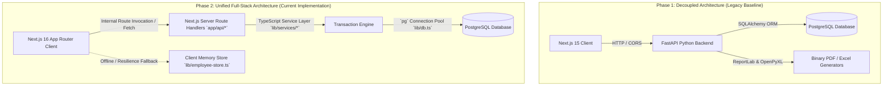
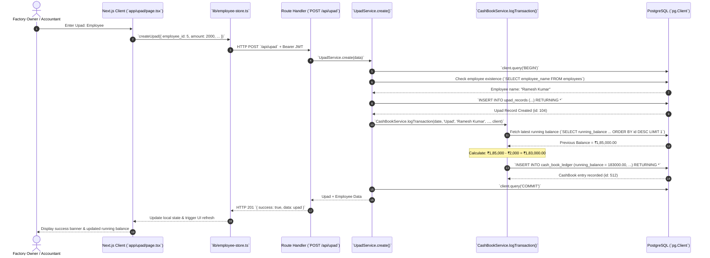

# RD Jeans Factory Management System - System Architecture

## 1. Architectural Overview & Evolution

The **RD Jeans Factory Management System** is built on a full-stack, modular architecture designed for high responsiveness, real-time consistency, and straightforward deployment.

### Architecture Evolution: From Python FastAPI to Full-Stack Next.js

During the development lifecycle, the system underwent a major architectural transition:



### Rationale for Architectural Consolidation:
1. **Simplified Deployment**: Consolidating backend and frontend into a unified Next.js App Router eliminates multi-container deployment friction, complex CORS headers, and separate process monitoring for small-to-medium factory installations.
2. **Type Safety Across Boundaries**: Shared TypeScript interfaces between client components and backend controllers reduce data modeling mismatches.
3. **Optimized Latency**: Route handlers running in the same Node.js runtime as the frontend server eliminate redundant network hops for server-rendered components.

---

## 2. Multi-Layer Component Architecture

```mermaid
graph TB
    subgraph "1. Presentation Layer (Client)"
        UI_DSH[Dashboard Page `app/page.tsx`]
        UI_EMP[Employees `app/employees/`]
        UI_UPD[Upad Advance `app/upad/`]
        UI_SAL[Salary Tracker `app/salary/`]
        UI_ROL[Roll Inventory `app/rolls/`]
        UI_CUT[Cutting Lots `app/cutting/`]
        UI_STH[Seth Clients `app/seths/`]
        UI_CSH[Cashbook Passbook `app/cashbook/`]
        UI_PRT[Partner Ledgers `app/partners/`]
        UI_REP[Reports Center `app/reports/`]
        UI_LOG[Login `app/login/`]
        UI_STORE[In-Memory Store `lib/employee-store.ts`]
        UI_FETCH[HTTP Client `lib/api.ts`]
    end

    subgraph "2. Security & Routing Layer"
        MW[Edge Middleware `middleware.ts`]
        AUTH[JWT & Bcrypt Engine `lib/auth.ts`]
    end

    subgraph "3. API Route Handler Layer (`app/api/*`)"
        API_AUTH[`/api/auth/login`]
        API_EMP[`/api/employees/*`]
        API_UPD[`/api/upad/*`]
        API_SAL[`/api/salary/*`]
        API_ROL[`/api/rolls/*`]
        API_CUT[`/api/cutting/*`]
        API_STH[`/api/seths/*`]
        API_INC[`/api/income/*`]
        API_EXP[`/api/expenses/*`]
        API_CSH[`/api/cashbook/*`]
        API_PRT[`/api/partners/*`]
        API_REP[`/api/reports/*`]
    end

    subgraph "4. Domain Service & Transaction Layer (`lib/services/*`)"
        SVC_EMP[EmployeeService]
        SVC_UPD[UpadService]
        SVC_SAL[SalaryService]
        SVC_ROL[RollService]
        SVC_CUT[CuttingService]
        SVC_STH[SethService]
        SVC_INC[IncomeService]
        SVC_EXP[ExpenseService]
        SVC_CSH[CashBookService]
        SVC_PRT[PartnerService]
        SVC_REP[ReportService]
        SVC_DSH[DashboardService]
    end

    subgraph "5. Data Persistence Layer (`lib/db.ts`)"
        POOL[node-postgres `Pool` (Max: 20 Connections)]
        PG[(PostgreSQL 15+ Database)]
    end

    %% Wiring
    UI_LOG --> MW
    UI_DSH --> UI_FETCH
    UI_EMP --> UI_STORE --> UI_FETCH
    UI_FETCH --> API_EMP
    UI_FETCH --> API_UPD
    UI_FETCH --> API_SAL
    UI_FETCH --> API_ROL
    UI_FETCH --> API_CUT
    UI_FETCH --> API_STH
    UI_FETCH --> API_INC
    UI_FETCH --> API_EXP
    UI_FETCH --> API_CSH
    UI_FETCH --> API_PRT
    UI_FETCH --> API_REP

    API_AUTH --> AUTH
    API_EMP --> SVC_EMP
    API_UPD --> SVC_UPD
    API_SAL --> SVC_SAL
    API_ROL --> SVC_ROL
    API_CUT --> SVC_CUT
    API_STH --> SVC_STH
    API_INC --> SVC_INC
    API_EXP --> SVC_EXP
    API_CSH --> SVC_CSH
    API_PRT --> SVC_PRT
    API_REP --> SVC_REP

    SVC_UPD --> SVC_CSH
    SVC_SAL --> SVC_CSH
    SVC_STH --> SVC_CSH
    SVC_INC --> SVC_CSH
    SVC_EXP --> SVC_CSH
    SVC_CUT --> SVC_ROL

    SVC_EMP --> POOL
    SVC_CSH --> POOL
    SVC_ROL --> POOL
    POOL --> PG
```

---

## 3. Layer Breakdown & Responsibilities

### 3.1 Presentation Layer (Client Side)
* **Framework**: React 19 within Next.js 16 App Router.
* **Styling**: Tailwind CSS v4 and Vanilla CSS design tokens declared in `app/globals.css`.
* **Icons**: `lucide-react` modern lightweight iconography.
* **Component Architecture**: Atomic components in `components/` (`CashBalanceCard`, `DashboardHeader`, `FactorySummary`, `QuickAccess`, `RecentActivities`) assembled into functional pages in `app/`.
* **State & Resilience**: `lib/employee-store.ts` orchestrates remote API calls via `apiFetch()` and maintains `FALLBACK_STORE` to preserve page stability during network glitches.

### 3.2 Security & Interception Layer
* **Middleware (`middleware.ts`)**: Evaluates every request. Inspects the `rd_user` session cookie. Redirects unauthenticated requests to `/login` and authenticated requests away from `/login` directly to the dashboard.
* **Authentication Engine (`lib/auth.ts`)**: Generates and verifies HMAC-SHA256 JWT tokens. Uses `bcryptjs` for password verification, with a backward-compatible check for legacy plain-text seed credentials (`RD@123`).

### 3.3 Route Handler Layer (`app/api/*`)
* Implements Next.js HTTP Route Handlers (`GET`, `POST`, `PUT`, `DELETE`).
* Parses incoming JSON payloads, validates parameters, and marshals responses with standardized envelope schemas: `{ success: true, data: [...] }` or `{ success: false, detail: "..." }`.

### 3.4 Service & Transaction Layer (`lib/services/*`)
* Encapsulates all domain business logic, data calculations, and atomic operations.
* **Dual-Write Orchestration**: Modules mutating cash (`SalaryService`, `UpadService`, `IncomeService`, `ExpenseService`, `SethService`) acquire a transaction client via `getClient()`, execute a `BEGIN ... COMMIT` block, and log into `cash_book_ledger` via `CashBookService.logTransaction()`.
* **Roll Consumption Engine**: `CuttingService` automatically recalculates roll remaining meters and switches roll status (`Available` $\rightarrow$ `Partially Used` $\rightarrow$ `Completed`).

### 3.5 Persistence Layer (`lib/db.ts`)
* Uses `pg.Pool` with connection pooling limits (`max: 20`, `idleTimeoutMillis: 30000`, `connectionTimeoutMillis: 5000`).
* Dynamically detects whether connecting to `localhost` (disables SSL) or cloud PostgreSQL (Neon, Supabase, Railway, enabling `ssl: { rejectUnauthorized: false }`).

---

## 4. End-to-End Data Flow Architecture

### Primary Transaction Flow: Logging a Cash Payout (Salary or Upad)



---

## 5. Architectural Decision Records (ADRs)

### ADR-01: Consolidation into Full-Stack Next.js (Accepted)
* **Context**: The project originally maintained a Python FastAPI backend and a Next.js frontend. Managing two separate development environments, dependencies, and deployment pipelines created overhead.
* **Decision**: Migrate all FastAPI routes into Next.js App Router Route Handlers (`app/api/*`) and service classes (`lib/services/*`) using the `pg` database driver.
* **Consequences**:
  * *Positive*: Single repository, single build command (`npm run build`), single server process, zero CORS issues in production.
  * *Trade-off*: Python-specific binary report generation (ReportLab, OpenPyXL) was temporarily unlinked and must be rebuilt in Node.js or via an external micro-service.

### ADR-02: Direct Parameterized SQL Queries over Heavy ORMs (Accepted)
* **Context**: In high-throughput ledger operations, ORMs like Prisma or Drizzle add abstraction layers and complex schema generator binaries.
* **Decision**: Use `pg.Pool` directly with parameterized SQL statements (`$1, $2, ...`) and transactional clients (`BEGIN ... COMMIT`).
* **Consequences**:
  * *Positive*: Maximum execution speed, zero cold-start overhead, granular control over ACID transaction blocks.
  * *Trade-off*: Requires manual schema synchronization and writing raw DDL migration scripts.

### ADR-03: Centralized Dual-Write Cash Ledger with Forward Recalculation (Accepted)
* **Context**: Factory cash must reflect every financial touchpoint without delayed batch jobs.
* **Decision**: Require all financial service methods (`SalaryService`, `UpadService`, `IncomeService`, `ExpenseService`, `SethService`) to synchronously log to `cash_book_ledger` within the same database transaction.
* **Consequences**:
  * *Positive*: Zero discrepancy between operational records and financial cashbook.
  * *Trade-off*: Historical updates require running balance recalculation forward in time (`recalculateBalancesFrom()`).

---

## 6. Current Architectural Limitations & Recommended Improvements

| Current Limitation | Technical Risk | Recommended Improvement |
| :--- | :--- | :--- |
| **API Route Authentication Bypass** | `middleware.ts` excludes `/api` paths. Anyone can invoke `/api/employees`, `/api/salary` without a JWT token. | Implement an API authentication wrapper (`withAuth()`) or enforce middleware token inspection for all non-public API paths. |
| **Ledger Recalculation Scalability** | `recalculateBalancesFrom(startId)` performs an in-memory loop updating each row sequentially (`UPDATE cash_book_ledger SET running_balance = ...`). | Replace iterative updates with a single window-function SQL update: `UPDATE cash_book_ledger SET running_balance = sub.new_bal FROM (...)`. |
| **Connection Exhaustion on Serverless** | Serverless Next.js functions (e.g. Vercel) can exhaust PostgreSQL connections (`max: 20`). | Use connection poolers (PgBouncer, Neon Connection Pooler, or Supabase Transaction Pooler). |
| **Missing Schema Migration Framework** | Table definitions exist only in source code comments or past Python models; no automated migration tool runs on deployment. | Introduce a lightweight migration runner (such as `node-pg-migrate` or standalone SQL migration scripts). |
