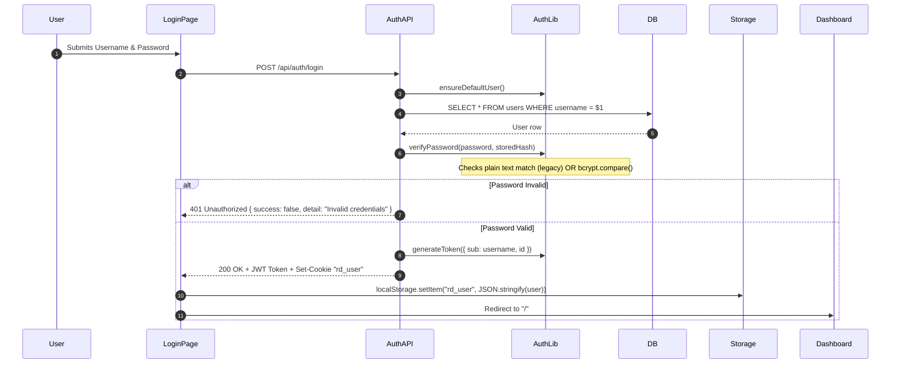
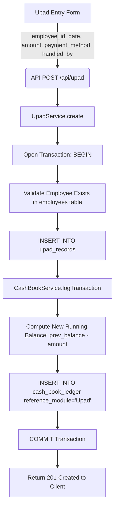
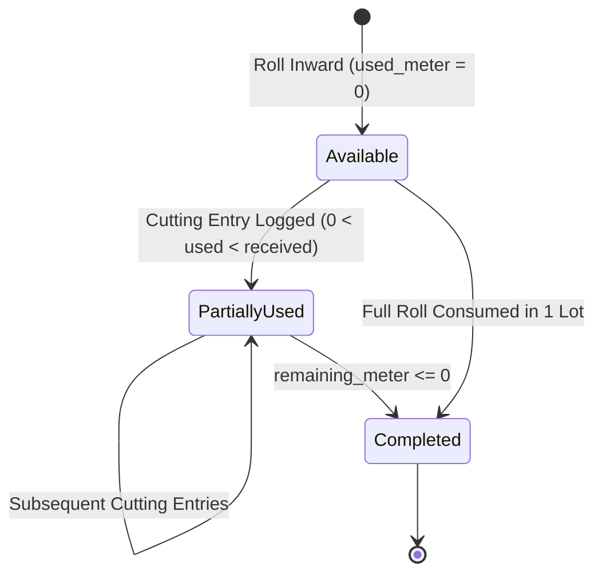
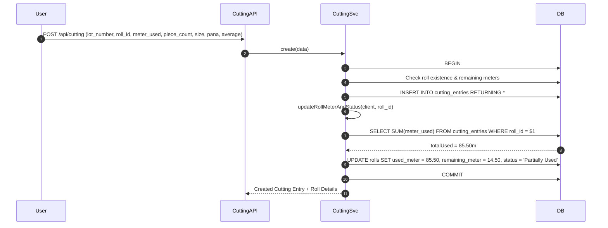

# RD Jeans Factory Management System - Detailed Module Documentation

This document provides technical, architectural, and business logic specifications for every functional module in the RD Jeans Factory Management System.

---

## Module Index
1. [Authentication & Session Module](#1-authentication--session-module)
2. [Dashboard & Analytics Module](#2-dashboard--analytics-module)
3. [Employee Management Module](#3-employee-management-module)
4. [Upad (Advance Payment) Module](#4-upad-advance-payment-module)
5. [Salary Management Module](#5-salary-management-module)
6. [Seth (Client) Module](#6-seth-client-module)
7. [Roll Inventory Module](#7-roll-inventory-module)
8. [Cutting Management Module](#8-cutting-management-module)
9. [Income Management Module](#9-income-management-module)
10. [Expense Management Module](#10-expense-management-module)
11. [Cashbook & General Ledger Module](#11-cashbook--general-ledger-module)
12. [Partner Accounts Module](#12-partner-accounts-module)
13. [Reporting Center Module](#13-reporting-center-module)

---

## 1. Authentication & Session Module

### 1.1 Purpose & Business Problem
Protects the factory's financial data, employee wage records, and fabric inventory from unauthorized external access. Provides single-sign-on credentials validation for factory owners and administrative personnel.

* **Related Requirements**: `REQ-AUTH-001`, `REQ-AUTH-002`, `REQ-AUTH-003`, `REQ-AUTH-004`, `REQ-AUTH-005`
* **Implementation Location**: [app/login/page.tsx](file:///d:/Akshay%20RD%20jeans/app/login/page.tsx), [app/api/auth/login/route.ts](file:///d:/Akshay%20RD%20jeans/app/api/auth/login/route.ts), [lib/auth.ts](file:///d:/Akshay%20RD%20jeans/lib/auth.ts), [middleware.ts](file:///d:/Akshay%20RD%20jeans/middleware.ts)

### 1.2 Technical Specifications
* **Inputs**: `username: string`, `password: string` (via JSON body to `/api/auth/login`).
* **Outputs**: JWT access token, user metadata object, and HTTP cookie `rd_user`.
* **Database Interactions**: Table `users` (`id`, `username`, `password_hash`, `created_at`).

### 1.3 Business Logic & Processing Flow

### 1.4 Current Status & Known Gaps
* **Status**: **Partially Implemented**.
* **Implemented**: Basic login, JWT generation, cookie-based edge middleware route interception, plain-text fallback for seed credentials (`rdjeans123` / `RD@123`).
* **Gaps**:
  1. API routes `/api/*` are excluded from middleware checks and do not inspect the Bearer JWT token.
  2. Legacy plain text password checking is insecure and must be replaced strictly with salted `bcrypt`.
  3. No role-based access control (RBAC) (e.g. separating read-only cutting floor master from factory owner).

---

## 2. Dashboard & Analytics Module

### 2.1 Purpose & Business Problem
Gives factory owners an instant, high-level operational and financial pulse of the factory upon opening the application, eliminating the need to cross-check multiple ledgers.

* **Related Requirements**: `REQ-DSH-001`, `REQ-DSH-002`, `REQ-DSH-003`, `REQ-DSH-004`, `REQ-DSH-005`
* **Implementation Location**: [app/page.tsx](file:///d:/Akshay%20RD%20jeans/app/page.tsx), [app/api/dashboard/route.ts](file:///d:/Akshay%20RD%20jeans/app/api/dashboard/route.ts), [lib/services/dashboard.ts](file:///d:/Akshay%20RD%20jeans/lib/services/dashboard.ts)

### 2.2 Technical Specifications
* **Inputs**: None (authenticated session).
* **Outputs**: Aggregated JSON containing active employee count, total upad issued, total salary paid, active rolls count, total pieces cut, current month income/expense, and cash balance summary.
* **Database Interactions**: Executes multi-table count and sum aggregations across `employees`, `upad_records`, `salaries`, `rolls`, `cutting_entries`, `expenses`, `incomes`, and `cash_book_ledger`.

### 2.3 Main Business Logic
1. `total_employees`: `SELECT COUNT(*) FROM employees WHERE status = 'Active'`
2. `total_upad`: `SELECT COALESCE(SUM(amount), 0) FROM upad_records`
3. `total_salary`: `SELECT COALESCE(SUM(paid_amount), 0) FROM salaries`
4. `active_rolls`: `SELECT COUNT(*) FROM rolls WHERE status != 'Completed'`
5. `total_pieces_cut`: `SELECT COALESCE(SUM(piece_count), 0) FROM cutting_entries`
6. `cash_summary`: Invokes `CashBookService.getDashboardSummary()` to fetch current liquid cash balance and month-to-date inflows/outflows.

### 2.4 Current Status & Recommendations
* **Status**: **Implemented**.
* **Recommendations**: Cache aggregate dashboard queries with a 30-second TTL or use a materialized view if transaction volume exceeds 50,000 ledger rows.

---

## 3. Employee Management Module

### 3.1 Purpose & Business Problem
Manages factory workers across stitching, cutting, and support departments. Tracks worker active status, date of joining, and role classification.

* **Related Requirements**: `REQ-EMP-001`, `REQ-EMP-002`, `REQ-EMP-003`, `REQ-EMP-004`
* **Implementation Location**: [app/employees/page.tsx](file:///d:/Akshay%20RD%20jeans/app/employees/page.tsx), [app/employees/[id]/page.tsx](file:///d:/Akshay%20RD%20jeans/app/employees/[id]/page.tsx), [app/api/employees/route.ts](file:///d:/Akshay%20RD%20jeans/app/api/employees/route.ts), [lib/services/employees.ts](file:///d:/Akshay%20RD%20jeans/lib/services/employees.ts)

### 3.2 Technical Specifications
* **Endpoints**:
  * `GET /api/employees` (Supports query filters: `search`, `role`, `status`)
  * `POST /api/employees` (Create worker)
  * `GET /api/employees/[id]` (Worker profile)
  * `PUT /api/employees/[id]` (Update worker profile/status)
  * `DELETE /api/employees/[id]` (Delete worker)
* **Allowed Roles**: `Stitching Worker`, `Cutting Worker`, `Helper`, `Indoor Staff`, `Outdoor Staff`, `Supervisor`.

### 3.3 Current Status & Recommendations
* **Status**: **Implemented**.
* **Recommendations**: Prevent physical deletion (`DELETE`) if foreign key references exist in `upad_records` or `salaries`; enforce soft-deletion (`status = 'Inactive'`).

---

## 4. Upad (Advance Payment) Module

### 4.1 Purpose & Business Problem
Textile workers frequently request mid-month cash advances. This module logs every advance against the worker, records the payment method and handling partner, and automatically deducts the amount from the factory cashbook.

* **Related Requirements**: `REQ-UPD-001`, `REQ-UPD-002`, `REQ-UPD-003`, `REQ-UPD-004`
* **Implementation Location**: [app/upad/page.tsx](file:///d:/Akshay%20RD%20jeans/app/upad/page.tsx), [app/upad/[id]/page.tsx](file:///d:/Akshay%20RD%20jeans/app/upad/[id]/page.tsx), [app/api/upad/route.ts](file:///d:/Akshay%20RD%20jeans/app/api/upad/route.ts), [lib/services/upad.ts](file:///d:/Akshay%20RD%20jeans/lib/services/upad.ts)

### 4.2 Step-by-Step Processing Flow

### 4.3 Validation Rules & Error Handling
* `amount` must be a positive number $> 0$.
* `handled_by` must be either `Rajubhai` or `Dhruveshbhai`.
* If database write fails at either Upad or Cashbook step, the entire transaction rolls back via `ROLLBACK`.

### 4.4 Current Status
* **Status**: **Implemented**.

---

## 5. Salary Management Module

### 5.1 Purpose & Business Problem
Calculates monthly wage settlements for employees, tracks partial payments, computes remaining unpaid balances, and provides complete visibility into advances taken during the month.

* **Related Requirements**: `REQ-SAL-001`, `REQ-SAL-002`, `REQ-SAL-003`, `REQ-SAL-004`
* **Implementation Location**: [app/salary/page.tsx](file:///d:/Akshay%20RD%20jeans/app/salary/page.tsx), [app/salary/[id]/page.tsx](file:///d:/Akshay%20RD%20jeans/app/salary/[id]/page.tsx), [app/api/salary/route.ts](file:///d:/Akshay%20RD%20jeans/app/api/salary/route.ts), [lib/services/salary.ts](file:///d:/Akshay%20RD%20jeans/lib/services/salary.ts)

### 5.2 Technical Specifications
* **Key Fields**: `employee_id`, `salary_month` (1-12), `salary_year`, `salary_amount`, `paid_amount`, `remaining_amount` (`salary_amount - paid_amount`), `payment_method`, `handled_by`, `payment_date`.
* **Cashbook Dual-Write**: If `paid_amount > 0`, an outflow record is written to `cash_book_ledger` with `reference_module = 'Salary'`.

### 5.3 Upad Deductions Business Logic
Before finalizing salary payment, the client calls `GET /api/upad/employee/[id]/summary?month=MM&year=YYYY`. The UI displays the total advances taken by that employee in the target month:
$$\text{Net Due Payout} = \text{Base Salary} - \text{Total Monthly Upad}$$
$$\text{Remaining Unpaid} = \text{Base Salary} - \text{Paid Amount}$$

### 5.4 Current Status
* **Status**: **Implemented**.

---

## 6. Seth (Client) Module

### 6.1 Purpose & Business Problem
Manages commercial relationships with external denim merchants ("Seths") who provide fabric for job-work cutting and stitching. Tracks client roll inventory and incoming job-work payment receipts.

* **Related Requirements**: `REQ-STH-001`, `REQ-STH-002`, `REQ-STH-003`, `REQ-STH-004`
* **Implementation Location**: [app/seths/page.tsx](file:///d:/Akshay%20RD%20jeans/app/seths/page.tsx), [app/seths/[id]/page.tsx](file:///d:/Akshay%20RD%20jeans/app/seths/[id]/page.tsx), [app/api/seths/route.ts](file:///d:/Akshay%20RD%20jeans/app/api/seths/route.ts), [lib/services/seths.ts](file:///d:/Akshay%20RD%20jeans/lib/services/seths.ts)

### 6.2 Sub-Operations
1. **Client Registry**: CRUD profiles (`seth_name`, `mobile_number`, `address`, `notes`, `status`).
2. **Client Payments (`seth_payments`)**: Logs payment received from a Seth. Automatically calls `CashBookService.logTransaction()` with `income_amount = payment.amount`, `transaction_type = 'Seth Payment'`.
3. **Associated Rolls**: Aggregates all rolls received from this Seth.

### 6.3 Current Status
* **Status**: **Implemented**.

---

## 7. Roll Inventory Module

### 7.1 Purpose & Business Problem
Tracks individual rolls of denim cloth delivered to the factory. Eliminates fabric loss by recording exact received meters and calculating remaining meters as fabric is consumed by cutting lots.

* **Related Requirements**: `REQ-ROL-001`, `REQ-ROL-002`, `REQ-ROL-003`, `REQ-ROL-004`
* **Implementation Location**: [app/rolls/page.tsx](file:///d:/Akshay%20RD%20jeans/app/rolls/page.tsx), [app/rolls/[id]/page.tsx](file:///d:/Akshay%20RD%20jeans/app/rolls/[id]/page.tsx), [app/api/rolls/route.ts](file:///d:/Akshay%20RD%20jeans/app/api/rolls/route.ts), [lib/services/rolls.ts](file:///d:/Akshay%20RD%20jeans/lib/services/rolls.ts)

### 7.2 State Lifecycle & Data Model

* **Table**: `rolls`
  * `seth_id`: Foreign key referencing client.
  * `roll_number` & `short_number`: Unique roll identifiers.
  * `received_meter`: Inward length in meters.
  * `used_meter`: Cumulative meters consumed.
  * `remaining_meter`: `received_meter - used_meter`.
  * `status`: `Available`, `Partially Used`, `Completed`.

### 7.3 Current Status
* **Status**: **Implemented**.

---

## 8. Cutting Management Module

### 8.1 Purpose & Business Problem
Logs cutting table operations where fabric rolls are laid into plies and cut into denim garment components. Tracks piece yields, fabric efficiency (average meter per piece), and automatically deducts consumed meters from raw roll inventory.

* **Related Requirements**: `REQ-CUT-001`, `REQ-CUT-002`, `REQ-CUT-003`, `REQ-CUT-004`
* **Implementation Location**: [app/cutting/page.tsx](file:///d:/Akshay%20RD%20jeans/app/cutting/page.tsx), [app/cutting/[id]/page.tsx](file:///d:/Akshay%20RD%20jeans/app/cutting/[id]/page.tsx), [app/api/cutting/route.ts](file:///d:/Akshay%20RD%20jeans/app/api/cutting/route.ts), [lib/services/cutting.ts](file:///d:/Akshay%20RD%20jeans/lib/services/cutting.ts)

### 8.2 Processing Flow & Roll Synchronization

### 8.3 Technical Production Metrics
* `layer_information`: Number of fabric layers spread on the table.
* `pana`: Fabric roll width (standard: 54", 58", 60").
* `average`: Calculated consumption metric: $\text{Average} = \frac{\text{meter\_used}}{\text{piece\_count}}$.

### 8.4 Current Status
* **Status**: **Implemented**.

---

## 9. Income Management Module

### 9.1 Purpose & Business Problem
Tracks non-Seth factory revenue (such as scrap fabric sales, auxiliary processing fees, or external loans) and ensures all incoming funds are credited to the factory cash balance.

* **Related Requirements**: `REQ-INC-001`, `REQ-INC-002`
* **Implementation Location**: [app/income/page.tsx](file:///d:/Akshay%20RD%20jeans/app/income/page.tsx), [app/income/[id]/page.tsx](file:///d:/Akshay%20RD%20jeans/app/income/[id]/page.tsx), [app/api/income/route.ts](file:///d:/Akshay%20RD%20jeans/app/api/income/route.ts), [lib/services/income.ts](file:///d:/Akshay%20RD%20jeans/lib/services/income.ts)

### 9.2 Technical Specifications
* **Fields**: `income_date`, `income_source`, `source_name`, `amount`, `payment_method`, `handled_by`, `reference_number`, `notes`.
* **Cashbook Dual-Write**: Calls `CashBookService.logTransaction()` with `income_amount = amount`, `out_amount = 0`, `reference_module = 'Income'`.

### 9.3 Current Status
* **Status**: **Implemented**.

---

## 10. Expense Management Module

### 10.1 Purpose & Business Problem
Monitors factory operational overheads (factory rent, industrial power, freight/transport, sewing machine maintenance, thread/zipper supplies).

* **Related Requirements**: `REQ-EXP-001`, `REQ-INC-002`
* **Implementation Location**: [app/expense/page.tsx](file:///d:/Akshay%20RD%20jeans/app/expense/page.tsx), [app/expense/[id]/page.tsx](file:///d:/Akshay%20RD%20jeans/app/expense/[id]/page.tsx), [app/api/expenses/route.ts](file:///d:/Akshay%20RD%20jeans/app/api/expenses/route.ts), [lib/services/expenses.ts](file:///d:/Akshay%20RD%20jeans/lib/services/expenses.ts)

### 10.2 Expense Categories
`Salary`, `Upad`, `Material`, `Transport`, `Electricity`, `Rent`, `Maintenance`, `Miscellaneous`.
* When an expense is created, updated, or deleted, `CashBookService` synchronizes the corresponding outflow record and recalculates subsequent running balances.

### 10.3 Current Status
* **Status**: **Implemented**.

---

## 11. Cashbook & General Ledger Module

### 11.1 Purpose & Business Problem
Serves as the single source of financial truth for RD Jeans. Mimics a physical bank passbook with strict chronological debit/credit entries, running cash balances, and multi-parameter filtering.

* **Related Requirements**: `REQ-CSH-001`, `REQ-CSH-002`, `REQ-CSH-003`, `REQ-CSH-004`
* **Implementation Location**: [app/cashbook/page.tsx](file:///d:/Akshay%20RD%20jeans/app/cashbook/page.tsx), [app/cashbook/[id]/page.tsx](file:///d:/Akshay%20RD%20jeans/app/cashbook/[id]/page.tsx), [app/api/cashbook/route.ts](file:///d:/Akshay%20RD%20jeans/app/api/cashbook/route.ts), [lib/services/cashbook.ts](file:///d:/Akshay%20RD%20jeans/lib/services/cashbook.ts)

### 11.2 Monotonic Balance Recalculation Algorithm
When an entry with ID $k$ is modified or deleted:
$$\text{For every row } i \ge k: \quad \text{running\_balance}_i = \text{running\_balance}_{i-1} + \text{income\_amount}_i - \text{out\_amount}_i$$
This logic is implemented in `CashBookService.recalculateBalancesFrom(startId, client)`.

### 11.3 Current Status
* **Status**: **Implemented**.

---

## 12. Partner Accounts Module

### 12.1 Purpose & Business Problem
Provides complete financial transparency between co-owners Rajubhai and Dhruveshbhai by tracking the net cash collected, spent, and held by each partner.

* **Related Requirements**: `REQ-PRT-001`, `REQ-PRT-002`, `REQ-PRT-003`
* **Implementation Location**: [app/partners/page.tsx](file:///d:/Akshay%20RD%20jeans/app/partners/page.tsx), [app/partners/[id]/page.tsx](file:///d:/Akshay%20RD%20jeans/app/partners/[id]/page.tsx), [app/api/partners/*](file:///d:/Akshay%20RD%20jeans/app/api/partners/), [lib/services/partners.ts](file:///d:/Akshay%20RD%20jeans/lib/services/partners.ts)

### 12.2 Metrics & Calculation
* `Rajubhai Inflow`: `SELECT SUM(income_amount) FROM cash_book_ledger WHERE handled_by = 'Rajubhai'`
* `Rajubhai Outflow`: `SELECT SUM(out_amount) FROM cash_book_ledger WHERE handled_by = 'Rajubhai'`
* `Rajubhai Net Balance`: $\text{Inflow} - \text{Outflow}$
* (Identical calculation for Dhruveshbhai).

### 12.3 Current Status & Recommendations
* **Status**: **Partially Implemented**.
* **Recommendations**: Add a dedicated equity transactions table (`partner_investments`, `partner_drawings`) to separate owner capital infusions from daily cash desk handling.

---

## 13. Reporting Center Module

### 13.1 Purpose & Business Problem
Compiles operational data into downloadable audit reports across all 11 business categories for tax accounting, client billing, and internal auditing.

* **Related Requirements**: `REQ-REP-001`, `REQ-REP-002`, `REQ-REP-003`, `REQ-REP-004`, `REQ-REP-005`
* **Implementation Location**: [app/reports/page.tsx](file:///d:/Akshay%20RD%20jeans/app/reports/page.tsx), [app/reports/[category]/page.tsx](file:///d:/Akshay%20RD%20jeans/app/reports/[category]/page.tsx), [app/api/reports/route.ts](file:///d:/Akshay%20RD%20jeans/app/api/reports/route.ts), [app/api/reports/export/route.ts](file:///d:/Akshay%20RD%20jeans/app/api/reports/export/route.ts), [lib/services/reports.ts](file:///d:/Akshay%20RD%20jeans/lib/services/reports.ts)

### 13.2 Current Implementation vs. Business Requirements
| Format | Business Requirement | Current Next.js Implementation Status | Notes |
| :--- | :--- | :--- | :--- |
| **JSON** | API Data Access | ✅ Fully Implemented (`/api/reports`) | Returns records array + counts. |
| **CSV** | Raw Data Export | ✅ Fully Implemented (`/api/reports/export?format=csv`) | Generates RFC 4180 CSV attachment. |
| **Excel (.xlsx)** | Formatted Spreadsheet | ❌ **Missing in Next.js API** (Was in Python FastAPI) | UI calls `/reports/export/excel`, returns 404. |
| **PDF (.pdf)** | Print-Ready Document | ❌ **Missing in Next.js API** (Was in Python FastAPI) | UI calls `/reports/export/pdf`, returns 404. |

### 13.3 Remediation Recommendation
Integrate `exceljs` for server-side spreadsheet generation and `@react-pdf/renderer` or `pdfkit` in Node.js route handlers to restore binary document generation without requiring a Python microservice.
