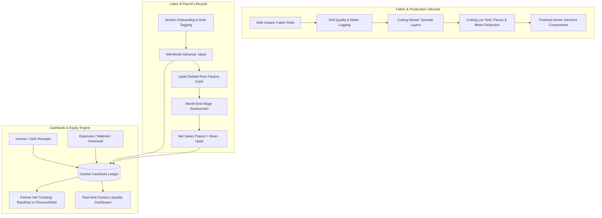
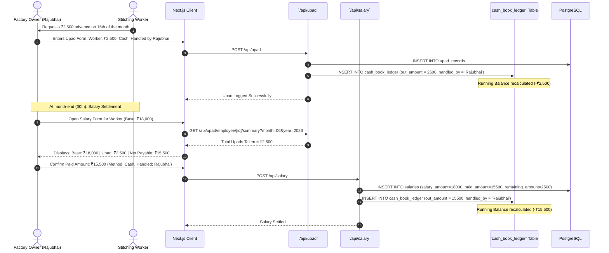
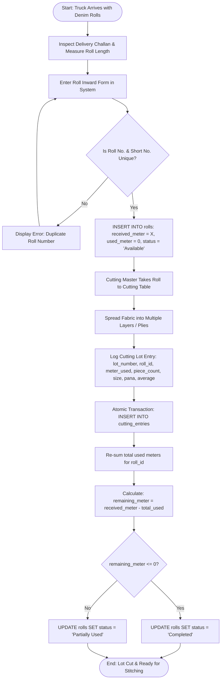
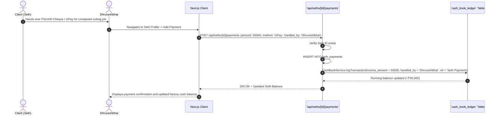
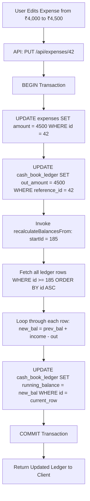

# RD Jeans Factory Management System - End-to-End Business Workflows

This document details the primary operational and financial workflows of the RD Jeans Factory. Every workflow traces user triggers, preconditions, validation logic, database mutations, side effects, and terminal states.

---

## 1. Core Workflow Map



---

## 2. Workflow 1: Worker Onboarding, Advance (Upad) Issuance & Salary Settlement

### 2.1 Workflow Summary
* **Trigger**: Factory Owner or Accountant.
* **Preconditions**: Worker is employed at the factory; factory cash drawer has sufficient funds.
* **Primary Actors**: Rajubhai or Dhruveshbhai, Factory Accountant, Worker.

### 2.2 Sequence Diagram



### 2.3 Step-by-Step Processing & Business Rules
1. **Upad Recording**:
   * Validates worker exists and is marked `status = 'Active'`.
   * Sets `reference_module = 'Upad'`, `out_amount = amount`.
   * Running cash balance decreases immediately by the advance amount.
2. **Salary Calculation**:
   * Base salary liability is recorded for the specific calendar month and year.
   * `remaining_amount` is calculated: $\text{salary\_amount} - \text{paid\_amount}$.
   * If `paid_amount > 0`, an outflow is logged in the cashbook.

---

## 3. Workflow 2: Fabric Roll Inward, Cutting Lot Production & Inventory Deduction

### 3.1 Workflow Summary
* **Trigger**: Fabric Delivery from Seth / Fabric Mill.
* **Preconditions**: Seth profile registered in system.
* **Primary Actors**: Cutting Floor Master, Factory Accountant.

### 3.2 Processing Flowchart



### 3.3 Success & Failure Paths
* **Success Path**: Cutting entry is logged, `meter_used` is deducted, roll status reflects new availability, and finished piece count increases.
* **Failure Path**: If the database connection drops during cutting lot entry, the `ROLLBACK` directive aborts both the cutting entry insert and the roll status update, maintaining meter integrity.

---

## 4. Workflow 3: Seth Job Order, Commercial Billing & Cash Receipt

### 4.1 Workflow Summary
* **Trigger**: Seth delivers cloth for stitching or settles job-work billing.
* **Primary Actors**: Seth, Co-Owner (Dhruveshbhai).

### 4.2 Sequence of Operations


---

## 5. Workflow 4: Operational Expense Logging & Running Balance Recalculation

### 5.1 Workflow Summary
* **Trigger**: Cash disbursement for factory rent, electricity bills, thread supplies, machine maintenance, or freight.
* **Primary Actors**: Rajubhai or Dhruveshbhai.

### 5.2 Recalculation On Back-Dated Entry Modification
When an expense entered 5 days ago is corrected (e.g. from ₹4,000 to ₹4,500):



---

## 6. Workflow 5: Period-End Reporting and Document Generation

### 6.1 Workflow Summary
* **Trigger**: Factory Accountant or Owner prepares monthly audit or tax summary.
* **Preconditions**: User specifies report category and date range.

### 6.2 Processing Flow
1. **User Selection**: Selects Report Type (`Cashbook`, `Salary`, `Upad`, `Cutting`, `Rolls`, `Seths`, `Expenses`) and Date Range (`2026-06-01` to `2026-06-30`).
2. **Data Query**: Next.js API queries SQL service with date bounds:
   ```sql
   SELECT * FROM cash_book_ledger 
   WHERE transaction_date >= $1 AND transaction_date <= $2 
   ORDER BY transaction_date DESC, id DESC
   ```
3. **Format Export**:
   * *JSON / CSV*: Route `/api/reports/export?format=csv` converts rows to RFC 4180 CSV with escaped quotes and returns downloadable attachment stream.
   * *Excel / PDF*: Planned enhancement via Node.js libraries (`exceljs`, `@react-pdf/renderer`).

---

## 7. Inconsistent & Incomplete Workflows Identified

1. **Unlinked Upad at Salary Settlement**: If an accountant enters a salary payout without inspecting the Upad summary, the system does not forcibly block the transaction or automatically apply the deduction.
2. **Missing Roll Negative Check**: If cutting meter exceeds remaining roll meter, the system calculates a negative balance without requiring supervisor approval.
3. **Partner Cash Transfer**: Currently, there is no workflow to record cash handoffs between Rajubhai and Dhruveshbhai (e.g. Rajubhai transferring ₹20,000 cash in hand to Dhruveshbhai).
