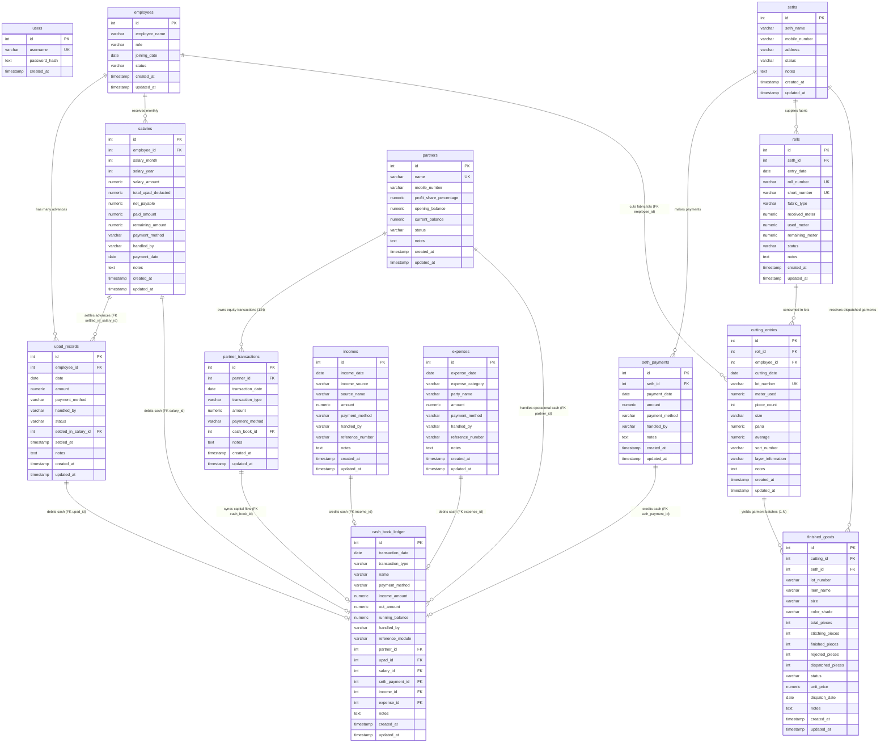

# RD Jeans Factory Management System - Database Design & Data Models

## 1. Database Architecture Overview

The RD Jeans Factory Management System uses **PostgreSQL (v15+)** as its relational persistence engine. The schema enforces strict referential integrity, decimal precision for financial amounts and fabric dimensions, and automatic timestamp tracking on all mutable entities.

### Technical Parameters
* **Database Engine**: PostgreSQL 15 / 16
* **Driver / Connection Client**: `node-postgres` (`pg` v8.22.0)
* **Connection Pooling**: Managed via `pg.Pool` (`lib/db.ts`) with maximum 20 active connections.
* **Character Set & Collation**: `UTF-8`

---

## 2. Complete Entity-Relationship (ER) Diagram



---

## 3. Production Data Definition Language (DDL) Script

The following script initializes the complete production schema for `rd_jeans_factory`. It can be executed directly in `psql` or `pgAdmin`.

```sql
-- =============================================================================
-- RD Jeans Factory Management System - Database Initialization Script
-- Target: PostgreSQL 15+
-- =============================================================================

-- 1. Users Table (Authentication)
CREATE TABLE IF NOT EXISTS users (
    id SERIAL PRIMARY KEY,
    username VARCHAR(100) UNIQUE NOT NULL,
    password_hash TEXT NOT NULL,
    created_at TIMESTAMP WITH TIME ZONE DEFAULT CURRENT_TIMESTAMP NOT NULL
);

-- Seed Default Administrative User (Password: RD@123)
INSERT INTO users (username, password_hash)
VALUES ('rdjeans123', 'RD@123')
ON CONFLICT (username) DO NOTHING;

-- 2. Employees Table
CREATE TABLE IF NOT EXISTS employees (
    id SERIAL PRIMARY KEY,
    employee_name VARCHAR(150) NOT NULL,
    role VARCHAR(80) NOT NULL,
    joining_date DATE NOT NULL,
    status VARCHAR(20) DEFAULT 'Active' NOT NULL,
    created_at TIMESTAMP WITH TIME ZONE DEFAULT CURRENT_TIMESTAMP NOT NULL,
    updated_at TIMESTAMP WITH TIME ZONE DEFAULT CURRENT_TIMESTAMP NOT NULL
);
CREATE INDEX IF NOT EXISTS idx_employees_name ON employees (employee_name);
CREATE INDEX IF NOT EXISTS idx_employees_status ON employees (status);

-- 3. Upad Records Table (Salary Advances)
CREATE TABLE IF NOT EXISTS upad_records (
    id SERIAL PRIMARY KEY,
    employee_id INTEGER NOT NULL REFERENCES employees(id) ON DELETE CASCADE,
    date DATE NOT NULL,
    amount NUMERIC(10, 2) NOT NULL CHECK (amount >= 0),
    payment_method VARCHAR(50) NOT NULL,
    handled_by VARCHAR(80) NOT NULL,
    status VARCHAR(20) DEFAULT 'Pending' NOT NULL CHECK (status IN ('Pending', 'Settled', 'Cancelled')),
    settled_in_salary_id INTEGER,
    settled_at TIMESTAMP WITH TIME ZONE,
    notes TEXT,
    created_at TIMESTAMP WITH TIME ZONE DEFAULT CURRENT_TIMESTAMP NOT NULL,
    updated_at TIMESTAMP WITH TIME ZONE DEFAULT CURRENT_TIMESTAMP NOT NULL
);
CREATE INDEX IF NOT EXISTS idx_upad_employee ON upad_records (employee_id);
CREATE INDEX IF NOT EXISTS idx_upad_date ON upad_records (date);
CREATE INDEX IF NOT EXISTS idx_upad_status ON upad_records (status);
CREATE INDEX IF NOT EXISTS idx_upad_settled_salary ON upad_records (settled_in_salary_id);

-- 4. Salaries Table (Monthly Wages & Payouts)
CREATE TABLE IF NOT EXISTS salaries (
    id SERIAL PRIMARY KEY,
    employee_id INTEGER NOT NULL REFERENCES employees(id) ON DELETE CASCADE,
    salary_month INTEGER NOT NULL CHECK (salary_month BETWEEN 1 AND 12),
    salary_year INTEGER NOT NULL CHECK (salary_year >= 2020),
    salary_amount NUMERIC(10, 2) NOT NULL,
    total_upad_deducted NUMERIC(10, 2) NOT NULL DEFAULT 0.00,
    net_payable NUMERIC(10, 2) NOT NULL,
    paid_amount NUMERIC(10, 2) NOT NULL DEFAULT 0.00,
    remaining_amount NUMERIC(10, 2) NOT NULL,
    payment_method VARCHAR(50) NOT NULL,
    handled_by VARCHAR(80) NOT NULL,
    payment_date DATE NOT NULL,
    notes TEXT,
    created_at TIMESTAMP WITH TIME ZONE DEFAULT CURRENT_TIMESTAMP NOT NULL,
    updated_at TIMESTAMP WITH TIME ZONE DEFAULT CURRENT_TIMESTAMP NOT NULL
);
CREATE INDEX IF NOT EXISTS idx_salaries_emp_month ON salaries (employee_id, salary_year, salary_month);

-- Foreign Key constraint linking upad_records to salaries
ALTER TABLE upad_records
    ADD CONSTRAINT fk_upad_settled_salary
    FOREIGN KEY (settled_in_salary_id) REFERENCES salaries(id) ON DELETE SET NULL;

-- 5. Seths Table (Clients / Cloth Job-Workers)
CREATE TABLE IF NOT EXISTS seths (
    id SERIAL PRIMARY KEY,
    seth_name VARCHAR(150) NOT NULL,
    mobile_number VARCHAR(30),
    address TEXT,
    notes TEXT,
    status VARCHAR(20) DEFAULT 'Active' NOT NULL,
    created_at TIMESTAMP WITH TIME ZONE DEFAULT CURRENT_TIMESTAMP NOT NULL,
    updated_at TIMESTAMP WITH TIME ZONE DEFAULT CURRENT_TIMESTAMP NOT NULL
);
CREATE INDEX IF NOT EXISTS idx_seths_name ON seths (seth_name);

-- 6. Seth Payments Table
CREATE TABLE IF NOT EXISTS seth_payments (
    id SERIAL PRIMARY KEY,
    seth_id INTEGER NOT NULL REFERENCES seths(id) ON DELETE CASCADE,
    payment_date DATE NOT NULL,
    amount NUMERIC(10, 2) NOT NULL CHECK (amount > 0),
    payment_method VARCHAR(50) NOT NULL,
    handled_by VARCHAR(80) NOT NULL,
    notes TEXT,
    created_at TIMESTAMP WITH TIME ZONE DEFAULT CURRENT_TIMESTAMP NOT NULL,
    updated_at TIMESTAMP WITH TIME ZONE DEFAULT CURRENT_TIMESTAMP NOT NULL
);
CREATE INDEX IF NOT EXISTS idx_seth_payments_seth ON seth_payments (seth_id);

-- 7. Rolls Table (Denim Fabric Inventory)
CREATE TABLE IF NOT EXISTS rolls (
    id SERIAL PRIMARY KEY,
    seth_id INTEGER NOT NULL REFERENCES seths(id) ON DELETE CASCADE,
    entry_date DATE NOT NULL,
    roll_number VARCHAR(80) UNIQUE NOT NULL,
    short_number VARCHAR(80) UNIQUE NOT NULL,
    fabric_type VARCHAR(100) NOT NULL,
    received_meter NUMERIC(10, 2) NOT NULL CHECK (received_meter > 0),
    used_meter NUMERIC(10, 2) DEFAULT 0.00 NOT NULL,
    remaining_meter NUMERIC(10, 2) NOT NULL,
    status VARCHAR(30) DEFAULT 'Available' NOT NULL,
    notes TEXT,
    created_at TIMESTAMP WITH TIME ZONE DEFAULT CURRENT_TIMESTAMP NOT NULL,
    updated_at TIMESTAMP WITH TIME ZONE DEFAULT CURRENT_TIMESTAMP NOT NULL
);
CREATE INDEX IF NOT EXISTS idx_rolls_seth ON rolls (seth_id);
CREATE INDEX IF NOT EXISTS idx_rolls_status ON rolls (status);

-- 8. Cutting Entries Table (Lot Cutting & Piece Production)
CREATE TABLE IF NOT EXISTS cutting_entries (
    id SERIAL PRIMARY KEY,
    cutting_date DATE NOT NULL,
    lot_number VARCHAR(80) UNIQUE NOT NULL,
    roll_id INTEGER NOT NULL REFERENCES rolls(id) ON DELETE CASCADE,
    employee_id INTEGER REFERENCES employees(id) ON DELETE SET NULL,
    meter_used NUMERIC(10, 2) NOT NULL CHECK (meter_used > 0),
    layer_information VARCHAR(100),
    piece_count INTEGER NOT NULL CHECK (piece_count > 0),
    size VARCHAR(40) NOT NULL,
    pana NUMERIC(10, 2),
    average NUMERIC(10, 2),
    sort_number VARCHAR(80),
    notes TEXT,
    created_at TIMESTAMP WITH TIME ZONE DEFAULT CURRENT_TIMESTAMP NOT NULL,
    updated_at TIMESTAMP WITH TIME ZONE DEFAULT CURRENT_TIMESTAMP NOT NULL
);
CREATE INDEX IF NOT EXISTS idx_cutting_roll ON cutting_entries (roll_id);
CREATE INDEX IF NOT EXISTS idx_cutting_date ON cutting_entries (cutting_date);
CREATE INDEX IF NOT EXISTS idx_cutting_employee ON cutting_entries (employee_id);
CREATE INDEX IF NOT EXISTS idx_cutting_emp_date ON cutting_entries (employee_id, cutting_date DESC);

-- 8a. Finished Goods & Garment Inventory Table (1:N with Cutting Lots)
CREATE TABLE IF NOT EXISTS finished_goods (
    id SERIAL PRIMARY KEY,
    cutting_id INTEGER NOT NULL REFERENCES cutting_entries(id) ON DELETE CASCADE,
    seth_id INTEGER REFERENCES seths(id) ON DELETE SET NULL,
    lot_number VARCHAR(80) NOT NULL,
    item_name VARCHAR(150) NOT NULL DEFAULT 'Denim Jeans',
    size VARCHAR(40) NOT NULL,
    color_shade VARCHAR(80) DEFAULT 'Standard Indigo',
    total_pieces INTEGER NOT NULL CHECK (total_pieces >= 0),
    stitching_pieces INTEGER DEFAULT 0 NOT NULL CHECK (stitching_pieces >= 0),
    finished_pieces INTEGER DEFAULT 0 NOT NULL CHECK (finished_pieces >= 0),
    rejected_pieces INTEGER DEFAULT 0 NOT NULL CHECK (rejected_pieces >= 0),
    dispatched_pieces INTEGER DEFAULT 0 NOT NULL CHECK (dispatched_pieces >= 0),
    status VARCHAR(40) DEFAULT 'Cut' NOT NULL CHECK (status IN ('Cut', 'In Stitching', 'Washing', 'Ready', 'Dispatched', 'Closed')),
    unit_price NUMERIC(10, 2) DEFAULT 0.00 NOT NULL,
    dispatch_date DATE,
    notes TEXT,
    created_at TIMESTAMP WITH TIME ZONE DEFAULT CURRENT_TIMESTAMP NOT NULL,
    updated_at TIMESTAMP WITH TIME ZONE DEFAULT CURRENT_TIMESTAMP NOT NULL
);
CREATE INDEX IF NOT EXISTS idx_finished_goods_cutting ON finished_goods (cutting_id);
CREATE INDEX IF NOT EXISTS idx_finished_goods_seth ON finished_goods (seth_id);
CREATE INDEX IF NOT EXISTS idx_finished_goods_lot ON finished_goods (lot_number);
CREATE INDEX IF NOT EXISTS idx_finished_goods_status ON finished_goods (status);

-- 9. Incomes Table (Non-Seth Operational Receipts)
CREATE TABLE IF NOT EXISTS incomes (
    id SERIAL PRIMARY KEY,
    income_date DATE NOT NULL,
    income_source VARCHAR(100) NOT NULL,
    source_name VARCHAR(150) NOT NULL,
    amount NUMERIC(10, 2) NOT NULL CHECK (amount > 0),
    payment_method VARCHAR(50) NOT NULL,
    handled_by VARCHAR(80) NOT NULL,
    reference_number VARCHAR(100),
    notes TEXT,
    created_at TIMESTAMP WITH TIME ZONE DEFAULT CURRENT_TIMESTAMP NOT NULL,
    updated_at TIMESTAMP WITH TIME ZONE DEFAULT CURRENT_TIMESTAMP NOT NULL
);

-- 10. Expenses Table (Operational Overhead Outflows)
CREATE TABLE IF NOT EXISTS expenses (
    id SERIAL PRIMARY KEY,
    expense_date DATE NOT NULL,
    expense_category VARCHAR(100) NOT NULL,
    party_name VARCHAR(150) NOT NULL,
    amount NUMERIC(10, 2) NOT NULL CHECK (amount > 0),
    payment_method VARCHAR(50) NOT NULL,
    handled_by VARCHAR(80) NOT NULL,
    reference_number VARCHAR(100),
    notes TEXT,
    created_at TIMESTAMP WITH TIME ZONE DEFAULT CURRENT_TIMESTAMP NOT NULL,
    updated_at TIMESTAMP WITH TIME ZONE DEFAULT CURRENT_TIMESTAMP NOT NULL
);
CREATE INDEX IF NOT EXISTS idx_expenses_category ON expenses (expense_category);
CREATE INDEX IF NOT EXISTS idx_expenses_date ON expenses (expense_date);

-- 11. Cash Book Ledger Table (Central Financial Passbook)
CREATE TABLE IF NOT EXISTS cash_book_ledger (
    id SERIAL PRIMARY KEY,
    transaction_date DATE NOT NULL,
    transaction_type VARCHAR(100) NOT NULL,
    name VARCHAR(150) NOT NULL,
    payment_method VARCHAR(50) NOT NULL,
    income_amount NUMERIC(10, 2) DEFAULT 0.00 NOT NULL,
    out_amount NUMERIC(10, 2) DEFAULT 0.00 NOT NULL,
    running_balance NUMERIC(10, 2) NOT NULL,
    handled_by VARCHAR(80) NOT NULL,
    reference_module VARCHAR(80) NOT NULL,
    reference_id INTEGER NOT NULL,
    upad_id INTEGER REFERENCES upad_records(id) ON DELETE CASCADE,
    salary_id INTEGER REFERENCES salaries(id) ON DELETE CASCADE,
    seth_payment_id INTEGER REFERENCES seth_payments(id) ON DELETE CASCADE,
    income_id INTEGER REFERENCES incomes(id) ON DELETE CASCADE,
    expense_id INTEGER REFERENCES expenses(id) ON DELETE CASCADE,
    notes TEXT,
    created_at TIMESTAMP WITH TIME ZONE DEFAULT CURRENT_TIMESTAMP NOT NULL,
    updated_at TIMESTAMP WITH TIME ZONE DEFAULT CURRENT_TIMESTAMP NOT NULL,
    CONSTRAINT chk_cash_book_exclusive_ref CHECK (
      (
        (CASE WHEN upad_id IS NOT NULL THEN 1 ELSE 0 END) +
        (CASE WHEN salary_id IS NOT NULL THEN 1 ELSE 0 END) +
        (CASE WHEN seth_payment_id IS NOT NULL THEN 1 ELSE 0 END) +
        (CASE WHEN income_id IS NOT NULL THEN 1 ELSE 0 END) +
        (CASE WHEN expense_id IS NOT NULL THEN 1 ELSE 0 END)
      ) <= 1
    )
);
CREATE INDEX IF NOT EXISTS idx_cashbook_date ON cash_book_ledger (transaction_date);
CREATE INDEX IF NOT EXISTS idx_cashbook_handled ON cash_book_ledger (handled_by);
CREATE INDEX IF NOT EXISTS idx_cashbook_ref ON cash_book_ledger (reference_module, reference_id);
CREATE INDEX IF NOT EXISTS idx_cashbook_upad_id ON cash_book_ledger (upad_id);
CREATE INDEX IF NOT EXISTS idx_cashbook_salary_id ON cash_book_ledger (salary_id);
CREATE INDEX IF NOT EXISTS idx_cashbook_seth_payment_id ON cash_book_ledger (seth_payment_id);
CREATE INDEX IF NOT EXISTS idx_cashbook_income_id ON cash_book_ledger (income_id);
CREATE INDEX IF NOT EXISTS idx_cashbook_expense_id ON cash_book_ledger (expense_id);
```

---

## 4. Entity Specifications & Constraints

### 4.1 Numerical Precision Standards
All monetary values and fabric dimensions use `NUMERIC(10, 2)` (up to ₹99,999,999.99 or 99,999,999.99 meters) rather than IEEE floating-point types (`float4` or `float8`). This avoids binary floating-point rounding errors in running balance calculations.

### 4.2 Referential Integrity & Cascade Rules
* `employees` $\rightarrow$ `upad_records`: `ON DELETE CASCADE` (deleting a worker drops their advances).
* `employees` $\rightarrow$ `salaries`: `ON DELETE CASCADE`.
* `seths` $\rightarrow$ `rolls`: `ON DELETE CASCADE`.
* `seths` $\rightarrow$ `seth_payments`: `ON DELETE CASCADE`.
* `rolls` $\rightarrow$ `cutting_entries`: `ON DELETE CASCADE`.
* `cash_book_ledger`: Enforces strict physical Foreign Key constraints with `ON DELETE CASCADE` via `upad_id`, `salary_id`, `seth_payment_id`, `income_id`, and `expense_id`. An Exclusive Arc check constraint ensures each ledger entry belongs to at most one entity (or 0 for manual entries). An atomic statement trigger (`trg_cash_book_after_delete`) automatically recalculates forward running balances using PostgreSQL window functions whenever source records are deleted.

---

## 5. Data Migration & Backup Strategy

1. **Daily Logical Dump**: Automated cron execution of `pg_dump`:
   ```bash
   pg_dump -U postgres -d rd_jeans_factory -F c -b -v -f "/backups/rd_jeans_$(date +%Y%m%d_%H%M%S).dump"
   ```
2. **Point-In-Time Recovery (PITR)**: When deployed on managed PostgreSQL (Neon / Supabase), continuous Write-Ahead Log (WAL) archiving enables recovery to any specific second.
3. **Schema Migrations**: Recommended introduction of `node-pg-migrate` to version-control future schema changes (e.g. adding piece-rate pay tables or partner capital accounts).
