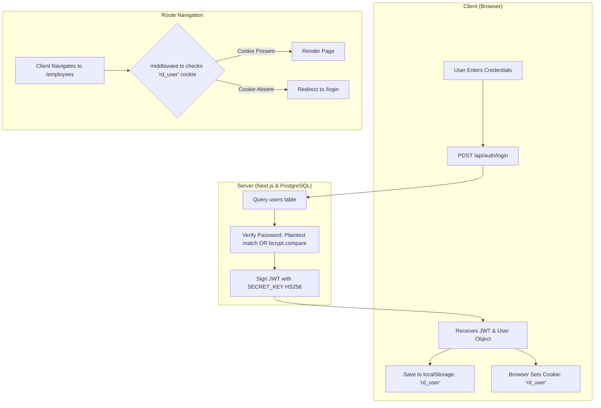

# RD Jeans Factory Management System - Authentication, Authorization & Security

## 1. Authentication Architecture & Current Baseline

The RD Jeans Factory Management System implements a hybrid session architecture combining signed JSON Web Tokens (JWT) for API requests and HTTP cookies for Next.js page route guards.



---

## 2. Token & Session Management

### 2.1 JWT Specifications
* **Signing Algorithm**: HMAC-SHA256 (`HS256`).
* **Payload Structure**:
  ```json
  {
    "sub": "rdjeans123",
    "id": 1,
    "iat": 1751280000,
    "exp": 1751281800
  }
  ```
* **Expiration**: Configurable via `ACCESS_TOKEN_EXPIRE_MINUTES` (defaults to 30 minutes in `.env.local`).
* **Signing Key Resolution**:
  ```typescript
  const SECRET_KEY = process.env.SECRET_KEY || process.env.JWT_SECRET || 'e2b6c9b3d7a8e8f4c0a5d2c8e3b1c6d9a4b8e7c1d3f5a2e9b0c7d6e5f4a3b2c1'
  ```

### 2.2 Client-Side Injection (`lib/api.ts`)
On every request made via `apiFetch()`, the client reads `localStorage.getItem("rd_user")`. If present, it injects the `Authorization: Bearer <token>` header:
```typescript
if (user && user.token && !headers.has("Authorization")) {
  headers.set("Authorization", `Bearer ${user.token}`)
}
```

---

## 3. Security Vulnerability Assessment & Evidence

Based on direct source code inspection of `middleware.ts`, `lib/auth.ts`, and `app/api/*`, the following security vulnerabilities have been identified:

### ✅ Vulnerability 1: Complete Lack of API Route Authentication (RESOLVED)
* **Status**: **RESOLVED** via updated [middleware.ts](file:///d:/Akshay%20RD%20jeans/middleware.ts).
* **Resolution**:
  - `middleware.ts` now intercepts all `/api/*` routes (except explicit public endpoints: `/api/auth/login` and `/api/health`).
  - Validates incoming `Authorization: Bearer <token>` or `rd_token` cookie using standard `jose` `jwtVerify`.
  - Rejects unauthenticated or invalid calls with `401 Unauthorized` and `WWW-Authenticate` header.
  - Injects authenticated user metadata (`x-user-id`, `x-user-name`) into request headers for downstream Route Handlers.
  - Automatically sets `HttpOnly` `rd_token` cookie upon successful authentication in `app/api/auth/login/route.ts`.

### ⚠️ Vulnerability 2: Plain-Text Password Fallback (HIGH)
* **Evidence**: In [lib/auth.ts](file:///d:/Akshay%20RD%20jeans/lib/auth.ts#L17-L20):
  ```typescript
  // Direct match check (for legacy plain text passwords like 'RD@123')
  if (password === storedHashOrPlain) {
    return true
  }
  ```
  The database seed script in [PROJECT_SETUP.md](file:///d:/Akshay%20RD%20jeans/PROJECT_SETUP.md#L170-L173) and `lib/auth.ts` seeds:
  ```sql
  INSERT INTO users (username, password_hash) VALUES ('rdjeans123', 'RD@123')
  ```
* **Impact**: Database dumps expose the administrative password in clear text.
* **Severity**: **HIGH**.

### ⚠️ Vulnerability 3: Hardcoded Fallback JWT Secret (MEDIUM)
* **Evidence**: In [lib/auth.ts](file:///d:/Akshay%20RD%20jeans/lib/auth.ts#L5):
  A fallback secret string (`'e2b6c9b3d7a8e8f4c0...'`) is hardcoded in source code if `process.env.SECRET_KEY` is undefined.
* **Impact**: An attacker knowing the hardcoded fallback can forge valid administrative JWT tokens.
* **Severity**: **MEDIUM**.

### ⚠️ Vulnerability 4: Non-HttpOnly Session Cookie (MEDIUM)
* **Evidence**: In [app/api/auth/login/route.ts](file:///d:/Akshay%20RD%20jeans/app/api/auth/login/route.ts#L38-L43) and [app/login/page.tsx](file:///d:/Akshay%20RD%20jeans/app/login/page.tsx#L31):
  The `rd_user` cookie is created with `httpOnly: false`.
* **Impact**: Client-side Cross-Site Scripting (XSS) attacks can steal or forge the session cookie.
* **Severity**: **MEDIUM**.

---

## 4. Hardening & Mitigation Action Plan

### Action 1: Enforce API Token Verification Middleware
Create an API guard utility (`lib/auth-guard.ts`):
```typescript
import { NextRequest, NextResponse } from "next/server"
import { verifyToken } from "@/lib/auth"

export async function authenticateApi(request: Request) {
  const authHeader = request.headers.get("Authorization")
  if (!authHeader || !authHeader.startsWith("Bearer ")) {
    return { authenticated: false, errorResponse: NextResponse.json({ success: false, detail: "Unauthorized: Missing or invalid token" }, { status: 401 }) }
  }

  const token = authHeader.split(" ")[1]
  const payload = verifyToken(token)
  if (!payload) {
    return { authenticated: false, errorResponse: NextResponse.json({ success: false, detail: "Unauthorized: Token expired or invalid" }, { status: 401 }) }
  }

  return { authenticated: true, user: payload }
}
```

### Action 2: Migrate Seed Credentials to Salted Bcrypt
Run a one-time migration replacing plain-text passwords:
```typescript
import { hashPassword } from './auth'
import { query } from './db'

export async function migratePasswords() {
  const res = await query('SELECT id, password_hash FROM users')
  for (const user of res.rows) {
    if (!user.password_hash.startsWith('$2a$') && !user.password_hash.startsWith('$2b$')) {
      const hashed = await hashPassword(user.password_hash)
      await query('UPDATE users SET password_hash = $1 WHERE id = $2', [hashed, user.id])
    }
  }
}
```

### Action 3: Restrict Cookie Scope to HttpOnly
Update login cookie flags:
```typescript
response.cookies.set('rd_user', user.username, {
  httpOnly: true,
  secure: process.env.NODE_ENV === 'production',
  sameSite: 'lax',
  path: '/',
  maxAge: 86400
})
```

---

## 5. Role-Based Access Control (RBAC) Matrix (Proposed)

Currently, the system operates on a single administrative tier. The following role-permission matrix is recommended for production scaling:

| Permission / Action | Super Admin (Rajubhai / Dhruveshbhai) | Factory Accountant | Cutting Master | Stitching Supervisor |
| :--- | :---: | :---: | :---: | :---: |
| **Manage Employees** | ✅ Full | ✅ Full | ❌ No Access | 👁️ Read-Only |
| **Issue Upad Advance** | ✅ Full | ✅ Full | ❌ No Access | ❌ No Access |
| **Settle Monthly Salary** | ✅ Full | ✅ Full | ❌ No Access | ❌ No Access |
| **Create Cutting Lots** | ✅ Full | ✅ Full | ✅ Full | ❌ No Access |
| **Record Roll Inward** | ✅ Full | ✅ Full | ✅ Full | ❌ No Access |
| **View Cashbook Ledger** | ✅ Full | ✅ Full | ❌ No Access | ❌ No Access |
| **View Partner Ledgers** | ✅ Full | ❌ No Access | ❌ No Access | ❌ No Access |
| **Export Audit Reports** | ✅ Full | ✅ Full | ❌ No Access | ❌ No Access |
