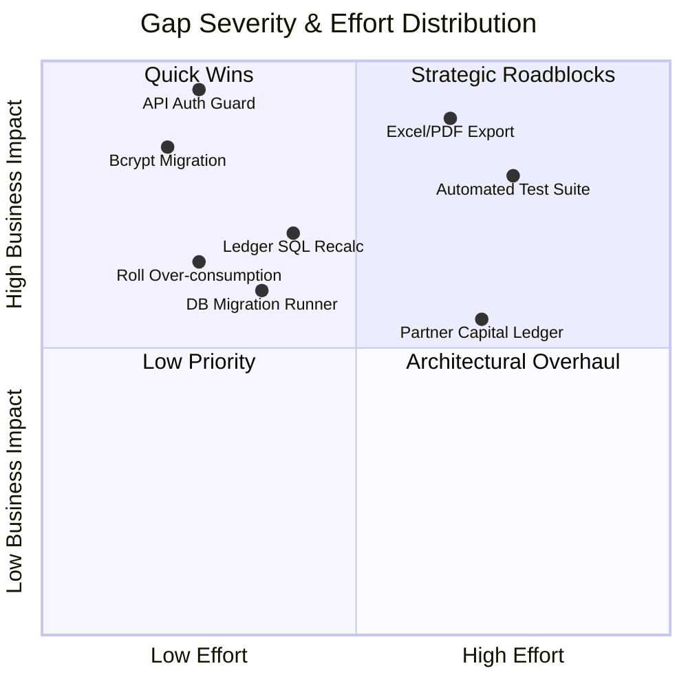

# RD Jeans Factory Management System - Gap Analysis & Improvement Plan

## 1. Executive Summary

This document presents a structured gap analysis comparing documented business requirements against the verified codebase. Gaps are categorized across **Security**, **Business Logic**, **Architecture & Performance**, and **Quality Assurance**.

Every item is evaluated with its **Root Cause**, **Business & Technical Impact**, **Concrete Solution**, and **Implementation Priority** (`Critical`, `High`, `Medium`, `Low`).

---

## 2. Gap Matrix & Impact Ranking



---

## 3. Detailed Gap Analysis by Domain

### 3.1 Security & Access Control Gaps

#### GAP-SEC-01: Unprotected API Endpoints (RESOLVED)
* **Status**: **RESOLVED** via [middleware.ts](file:///d:/Akshay%20RD%20jeans/middleware.ts).
* **Resolution**:
  - `middleware.ts` now intercepts all `/api/*` endpoints (excluding `/api/auth/login` and `/api/health`).
  - Verifies JWT tokens via `Authorization: Bearer <token>` or `rd_token` cookie using standard `jose` `jwtVerify`.
  - Rejects unauthenticated calls with `401 Unauthorized`.
  - Injects authenticated user headers (`x-user-id`, `x-user-name`) for downstream route handlers.

#### GAP-SEC-02: Plaintext Password Seed & Fallback Verification
* **Issue**: [lib/auth.ts](file:///d:/Akshay%20RD%20jeans/lib/auth.ts#L17-L20) permits direct string comparison: `if (password === storedHashOrPlain) return true`. The seed user `rdjeans123` is inserted with clear-text password `RD@123`.
* **Impact**: Exposes credentials in database logs, backups, and network dumps.
* **Proposed Solution**: Remove the plain-text comparison branch. Hash all existing user passwords with `bcrypt.hash(password, 10)` via a startup migration script.
* **Priority**: **HIGH**.

#### GAP-SEC-03: Hardcoded Fallback JWT Secret Key
* **Issue**: [lib/auth.ts](file:///d:/Akshay%20RD%20jeans/lib/auth.ts#L5) contains an embedded fallback hexadecimal secret string.
* **Impact**: If `.env` is unconfigured in production, tokens can be forged using the known public source string.
* **Proposed Solution**: Throw an explicit fatal exception on server startup if `process.env.SECRET_KEY` is not defined.
* **Priority**: **MEDIUM**.

---

### 3.2 Business Logic & Functional Gaps

#### GAP-BUS-01: Missing Excel (.xlsx) and PDF (.pdf) Export Handlers (RESOLVED)
* **Status**: **RESOLVED** via [app/api/reports/export/excel/route.ts](file:///d:/Akshay%20RD%20jeans/app/api/reports/export/excel/route.ts) and [app/api/reports/export/pdf/route.ts](file:///d:/Akshay%20RD%20jeans/app/api/reports/export/pdf/route.ts).
* **Resolution**:
  - Installed `exceljs`, `jspdf`, and `jspdf-autotable`.
  - Created dedicated endpoints `/api/reports/export/excel` and `/api/reports/export/pdf`.
  - Upgraded `ReportService` to support all 12 business categories with styled workbooks and printable landscape PDF documents.

#### GAP-BUS-02: Negative Meter Balance on Cutting Over-Consumption
* **Issue**: In [lib/services/cutting.ts](file:///d:/Akshay%20RD%20jeans/lib/services/cutting.ts#L35-L39), `remaining_meter = received_meter - totalUsed`. If `meter_used` exceeds remaining meters, `remaining_meter` becomes negative without raising an error.
* **Impact**: Skews physical fabric stock records; indicates more fabric was cut than physically delivered.
* **Proposed Solution**: Add an explicit check in `CuttingService.create()`:
  ```typescript
  if (data.meter_used > parseFloat(roll.remaining_meter)) {
    throw new Error(`Cannot cut ${data.meter_used}m. Roll only has ${roll.remaining_meter}m remaining.`);
  }
  ```
* **Priority**: **HIGH**.

#### GAP-BUS-03: Lack of Hard Upad Deduction Enforcement at Salary Settlement
* **Issue**: The salary creation route allows an accountant to enter any `paid_amount` without verifying or clearing the worker's active Upad balance for that month.
* **Impact**: Workers may take advances that are forgotten or omitted during salary payout, leading to wage overpayments.
* **Proposed Solution**: In `SalaryService.create()`, calculate total active Upad for the month and ensure `salary_amount - total_upad = max_payable`. Mark included Upad records as "Settled" to prevent double deduction.
* **Priority**: **HIGH**.

#### GAP-BUS-04: Partner Equity vs. Cash Desk Confusion (RESOLVED)
* **Status**: **RESOLVED** via migration [005_partners_table_and_ledger.sql](file:///d:/Akshay%20RD%20jeans/scripts/migrations/005_partners_table_and_ledger.sql).
* **Resolution**:
  - Created dedicated `partners` table with physical `id`, `profit_share_percentage`, `opening_balance`, and `current_balance`.
  - Created `partner_transactions` table ($1 : N$) with types: `Capital Investment`, `Drawing (Personal Withdrawal)`, `Profit Share`, `Cash Transfer`, and `Adjustment`.
  - Added physical foreign key `partner_id REFERENCES partners(id) ON DELETE SET NULL` on `cash_book_ledger`.
  - Differentiated Capital Equity from Operational Cash Handled in [lib/services/partners.ts](file:///d:/Akshay%20RD%20jeans/lib/services/partners.ts) and the dual-mode UI in [app/partners/page.tsx](file:///d:/Akshay%20RD%20jeans/app/partners/page.tsx).

---

### 3.3 Architecture & Data Integrity Gaps

#### GAP-ARC-01: Sequential In-Memory Ledger Recalculation Loop
* **Issue**: In [lib/services/cashbook.ts](file:///d:/Akshay%20RD%20jeans/lib/services/cashbook.ts#L21-L46), `recalculateBalancesFrom(startId)` fetches every row with $ID \ge startId$ and executes an individual `UPDATE` statement in a `for` loop.
* **Impact**: $O(N)$ database query roundtrips. When the ledger contains 20,000 entries, editing a record from 6 months ago will trigger 10,000 separate SQL queries, freezing the server and locking the table.
* **Proposed Solution**: Replace the iterative JavaScript loop with a single SQL query using the `SUM() OVER ()` window function:
  ```sql
  WITH updated_balances AS (
    SELECT 
      id,
      SUM(income_amount - out_amount) OVER (ORDER BY id ASC ROWS BETWEEN UNBOUNDED PRECEDING AND CURRENT ROW) AS new_balance
    FROM cash_book_ledger
  )
  UPDATE cash_book_ledger c
  SET running_balance = u.new_balance, updated_at = NOW()
  FROM updated_balances u
  WHERE c.id = u.id AND c.id >= $1;
  ```
* **Priority**: **HIGH**.

#### GAP-ARC-02: Missing Schema Migration Management
* **Issue**: The Next.js repository has no database migration tool (e.g. `node-pg-migrate`, `drizzle-kit`, or `prisma`). Database tables must be created manually via external SQL queries.
* **Impact**: High risk of schema drift between development and production databases.
* **Proposed Solution**: Install `node-pg-migrate` and commit versioned SQL migration scripts to `migrations/`.
* **Priority**: **MEDIUM**.

---

### 3.4 Quality Assurance & Testing Gaps

#### GAP-QA-01: Zero Automated Test Coverage
* **Issue**: The repository contains no unit tests, integration tests, or end-to-end tests.
* **Impact**: Critical business logic (cash balance calculation, roll deduction, salary settlement) can silently break during refactoring or package upgrades.
* **Proposed Solution**: Configure Vitest for service unit tests and Playwright for core user workflows.
* **Priority**: **HIGH**.
