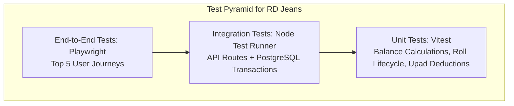

# RD Jeans Factory Management System - Testing Strategy & Quality Assurance

## 1. Testing Framework & Philosophy

The RD Jeans Factory Management System processes daily cash movements, worker wage obligations, and physical raw material inventories. Flaws in calculation algorithms or race conditions in transaction logging directly result in financial losses.

A multi-tiered testing strategy is required to elevate the system from its current 64.5% baseline to 100% production readiness.

---

## 2. Test Tiers & Scope

### 2.1 Unit Testing (Domain Services & Calculations)
* **Target Modules**: `CashBookService`, `CuttingService`, `SalaryService`, `UpadService`, `RollService`.
* **Focus**: Pure algorithmic verification:
  * Monotonic balance calculation ($Balance_i = Balance_{i-1} + Inflow - Outflow$).
  * Roll status state machine (`Available` $\rightarrow$ `Partially Used` $\rightarrow$ `Completed`).
  * Net salary due calculation ($\text{Salary} - \text{Monthly Upad}$).

### 2.2 Integration Testing (API Routes & Transactions)
* **Target Modules**: `app/api/*` communicating with a dedicated test PostgreSQL container.
* **Focus**:
  * Atomicity verification: Ensure that if an insert into `salaries` succeeds but `cash_book_ledger` fails, the entire transaction rolls back cleanly.
  * Referential cascade verification: Confirm that deleting a worker cascades to advance logs.

### 2.3 End-to-End (E2E) Browser Testing
* **Target Tool**: Playwright.
* **Focus**: Full browser journeys:
  1. Login with credentials $\rightarrow$ redirect to dashboard.
  2. Register new worker $\rightarrow$ issue Upad $\rightarrow$ verify cash card decreases on dashboard.
  3. Register fabric roll $\rightarrow$ enter cutting lot $\rightarrow$ verify roll status turns `Partially Used`.
  4. Generate and download monthly CSV report.

---

## 3. Comprehensive Test Case Catalog

| Test ID | Req ID | Scenario | Preconditions | Test Steps | Expected Result | Current Status |
| :--- | :--- | :--- | :--- | :--- | :--- | :---: |
| **TC-AUTH-01** | `REQ-AUTH-001` | Valid Login | Default user `rdjeans123` seeded | 1. Enter `rdjeans123` / `RD@123` 2. Click Submit | Status 200, JWT returned, cookie set, redirect to `/` | **Passed (Manual)** |
| **TC-AUTH-02** | `REQ-AUTH-001` | Invalid Password | User exists in DB | 1. Enter `rdjeans123` / `WrongPass` 2. Click Submit | Status 401, error banner displayed, stay on `/login` | **Passed (Manual)** |
| **TC-AUTH-03** | `REQ-AUTH-003` | Unauthenticated Navigation | No session cookie | 1. Open browser directly to `/employees` | Intercepted by middleware, redirected to `/login` | **Passed (Manual)** |
| **TC-AUTH-04** | `REQ-AUTH-005` | Direct API Invocation without Token | None | 1. Send `POST /api/employees` via cURL without Authorization header | Should return 401 Unauthorized | ❌ **Failed (Gap)** |
| **TC-ROL-01** | `REQ-ROL-001` | Register Valid Fabric Roll | Seth ID 1 exists | 1. Enter roll `RL-101`, short `SH-1`, 100 meters 2. Submit | Roll created, `used_meter = 0`, `status = 'Available'` | **Passed (Manual)** |
| **TC-ROL-02** | `REQ-ROL-004` | Duplicate Roll Number Rejection | Roll `RL-101` already in DB | 1. Enter roll `RL-101` again 2. Submit | Database rejects with unique constraint violation | **Passed (Manual)** |
| **TC-CUT-01** | `REQ-CUT-001` | Standard Cutting Lot Logging | Roll with 100m available | 1. Enter cutting lot for 40 meters, 30 pieces | Lot created, roll `used_meter` becomes 40m, `status = 'Partially Used'` | **Passed (Manual)** |
| **TC-CUT-02** | `REQ-CUT-003` | Complete Roll Consumption | Roll with 60m remaining | 1. Enter cutting lot for 60 meters | Lot created, roll `remaining_meter` becomes 0m, `status = 'Completed'` | **Passed (Manual)** |
| **TC-CUT-03** | `REQ-CUT-004` | Cutting Exceeding Available Meters | Roll with 10m remaining | 1. Attempt cutting lot for 25 meters | System should reject with error | ❌ **Failed (Gap)** |
| **TC-UPD-01** | `REQ-UPD-001` | Upad Advance Creation | Active employee exists | 1. Issue ₹3,000 Upad to Worker #1 via Rajubhai | Upad record created, Cashbook logs ₹3,000 outflow | **Passed (Manual)** |
| **TC-SAL-01** | `REQ-SAL-001` | Monthly Salary Payout | Worker has base salary ₹15,000 | 1. Record salary payment of ₹12,000 | Salary record created, `remaining_amount = 3000`, Cashbook logs ₹12,000 outflow | **Passed (Manual)** |
| **TC-SAL-02** | `REQ-SAL-002` | Upad Deduction Settlement | Worker took ₹3,000 Upad in June | 1. Open June salary settlement for Worker | UI displays ₹3,000 Upad taken, net payable ₹12,000 | **Passed (Manual)** |
| **TC-CSH-01** | `REQ-CSH-002` | Running Balance Monotonicity | Cashbook has 5 transactions | 1. Query `/api/cashbook` 2. Verify running balance of row $i$ | $Balance_i = Balance_{i-1} + In_i - Out_i$ holds for all rows | **Passed (Manual)** |
| **TC-CSH-02** | `REQ-CSH-003` | Historical Transaction Update Recalculation | 10 transactions in Cashbook | 1. Edit outflow on transaction #3 from ₹1,000 to ₹1,500 | Rows 3 through 10 have running balances decreased by exactly ₹500 | **Passed (Manual)** |
| **TC-REP-01** | `REQ-REP-005` | CSV Report Export | Cashbook data exists | 1. Request `/api/reports/export?category=cashbook&format=csv` | HTTP 200, valid RFC 4180 CSV attachment returned | **Passed (Manual)** |
| **TC-REP-02** | `REQ-REP-003` | Excel Report Export | Salary data exists | 1. Request Excel download from `/reports` page | Should download formatted `.xlsx` file | ❌ **Failed (404 Gap)** |
| **TC-REP-03** | `REQ-REP-004` | PDF Report Export | Salary data exists | 1. Request PDF download from `/reports` page | Should download formatted `.pdf` file | ❌ **Failed (404 Gap)** |

---

## 4. Current Test Execution Evidence

* **Automated Test Runners**: None currently present in `package.json` (`npm run test` is not defined).
* **Manual Verification Status**: Primary happy paths (Login, Employee CRUD, Roll Inward, Cutting Lots, Upad, Cashbook viewing) have been manually verified during development.
* **Formal Testing Claim**: No automated test passes are claimed. Establishing automated unit and integration tests is designated as **Priority Milestone 1** in the Development Roadmap.
