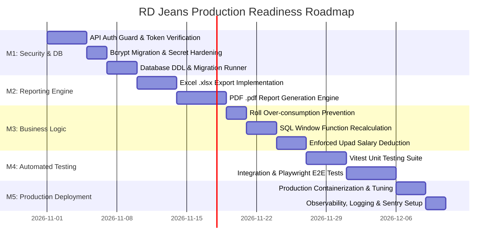

# RD Jeans Factory Management System - Development Roadmap

## 1. Roadmap Overview & Strategic Objectives

This roadmap provides a phased, actionable execution plan to transition the RD Jeans Factory Management System from its current **64.5% implementation baseline** to **100% production readiness**.

Work is organized into five logical, dependency-ordered milestones:

---

## 2. Milestone 1: Critical Security Hardening & Database Stabilization

### `TSK-M1-01`: API Route Authentication Guard
* **Description**: Create higher-order API authentication wrapper (`withAuth`) verifying Bearer JWT tokens on all non-public `/api/*` routes.
* **Reason**: Critical vulnerability: API endpoints currently execute without token verification.
* **Dependencies**: None.
* **Priority**: **Critical (Blocker)**.
* **Expected Outcome**: Unauthenticated cURL or fetch calls to `/api/employees`, `/api/salary`, etc., receive `401 Unauthorized`.
* **Definition of Done (DoD)**: All 14 API route handlers wrapped; unauthorized requests rejected; tests confirm valid tokens pass through.

### `TSK-M1-02`: Bcrypt Password Hashing & Secret Enforcement
* **Description**: Remove plain-text password fallback check from [lib/auth.ts](file:///d:/Akshay%20RD%20jeans/lib/auth.ts). Re-hash seed password `RD@123` with 10 salt rounds. Throw a fatal startup error if `SECRET_KEY` is not set in `.env`.
* **Reason**: Eliminates plain-text credentials exposure and hardcoded secret vulnerabilities.
* **Dependencies**: None.
* **Priority**: **High**.
* **Expected Outcome**: All database passwords stored as `$2a$` or `$2b$` bcrypt hashes.
* **Definition of Done (DoD)**: Zero plain-text passwords in database; plain text comparison code removed; unit test verifies invalid hashes are rejected.

### `TSK-M1-03`: Database Schema Versioning & Migration Setup
* **Description**: Integrate `node-pg-migrate` or standalone SQL migration scripts to execute the production DDL from [docs/06-database-design.md](file:///d:/Akshay%20RD%20jeans/docs/06-database-design.md).
* **Reason**: Prevents manual schema creation errors and enables continuous integration deployments.
* **Dependencies**: None.
* **Priority**: **High**.
* **Expected Outcome**: `npm run migrate:up` creates all 11 tables, constraints, and indexes idempotently.
* **Definition of Done (DoD)**: Fresh database container can be completely initialized from zero via a single command.

---

## 3. Milestone 2: Reporting & Document Export Engine

### `TSK-M2-01`: Server-Side Excel (.xlsx) Report Generator
* **Description**: Implement route handler `GET /api/reports/export/excel` using `exceljs`.
* **Reason**: Fulfills `REQ-REP-003`; resolves 404 error when clicking "Export Excel" on `/reports` page.
* **Dependencies**: `TSK-M1-01`.
* **Priority**: **High**.
* **Expected Outcome**: Users receive formatted `.xlsx` files with styled headers, alternating row colors, date filters in the title block, and currency formatting for amount columns.
* **Definition of Done (DoD)**: Excel files open cleanly in Microsoft Excel and LibreOffice without corruption warnings across all 11 categories.

### `TSK-M2-02`: Printable PDF (.pdf) Report Generator
* **Description**: Implement route handler `GET /api/reports/export/pdf` using `@react-pdf/renderer` or `pdfkit`.
* **Reason**: Fulfills `REQ-REP-004`; provides print-ready salary slips, monthly cashbook statements, and cutting lot summaries.
* **Dependencies**: `TSK-M1-01`.
* **Priority**: **High**.
* **Expected Outcome**: Clean, vector-based PDF download with RD Jeans letterhead, page numbers, and responsive table columns.
* **Definition of Done (DoD)**: PDF renders within 800ms; multi-page tables paginate cleanly with repeating headers.

---

## 4. Milestone 3: Business Logic & Data Integrity Hardening

### `TSK-M3-01`: Roll Over-Consumption Prevention Guard
* **Description**: Add guard logic in `CuttingService.create()` to reject cutting lots where `meter_used > remaining_meter`.
* **Reason**: Prevents physical fabric records from dropping into negative values.
* **Dependencies**: None.
* **Priority**: **High**.
* **Expected Outcome**: User attempting to cut 60m from a roll with only 40m remaining receives a clear validation error: `"Insufficient fabric meters available"`.
* **Definition of Done (DoD)**: API returns 400 Bad Request on overage; database constraint or service guard prevents negative values.

### `TSK-M3-02`: SQL Window Function Ledger Recalculation
* **Description**: Refactor `CashBookService.recalculateBalancesFrom()` to use a single SQL `SUM() OVER ()` window query instead of an iterative Node.js row update loop.
* **Reason**: Eliminates $O(N)$ database round-trips and prevents ledger update locks as the table scales.
* **Dependencies**: None.
* **Priority**: **High**.
* **Expected Outcome**: Modifying a historical transaction recalculates 10,000 ledger rows in under 50ms.
* **Definition of Done (DoD)**: Benchmark confirms sub-100ms execution on a 10,000-row test dataset.

### `TSK-M3-03`: Enforced Upad Deduction at Salary Settlement
* **Description**: Modify `SalaryService.create()` to validate that the worker's active Upad balance for the target month is explicitly acknowledged or deducted, and transition those advances to "Settled".
* **Reason**: Prevents wage overpayments and advance calculation disputes.
* **Dependencies**: None.
* **Priority**: **Medium**.
* **Expected Outcome**: Net payout calculation is enforced by backend logic rather than relying solely on frontend math.
* **Definition of Done (DoD)**: Unit test verifies that recording salary marks active month Upads as settled.

---

## 5. Milestone 4: Comprehensive Automated Testing & CI/CD

### `TSK-M4-01`: Vitest Unit Testing Framework
* **Description**: Install and configure `vitest` to run unit tests against domain calculation services (`CashBookService`, `SalaryService`, `CuttingService`).
* **Reason**: Eliminates regression risks on core financial and inventory math.
* **Dependencies**: None.
* **Priority**: **High**.
* **Expected Outcome**: `npm run test:unit` executes in under 5 seconds with $> 85\%$ coverage on domain services.
* **Definition of Done (DoD)**: 40+ unit test assertions covering happy paths and edge cases passing in CI.

### `TSK-M4-02`: Playwright End-to-End Test Suite
* **Description**: Configure Playwright browser tests covering the 5 primary user workflows detailed in [docs/05-business-workflows.md](file:///d:/Akshay%20RD%20jeans/docs/05-business-workflows.md).
* **Reason**: Guarantees that user interface interactions correctly trigger backend mutations.
* **Dependencies**: `TSK-M1-01`, `TSK-M3-01`.
* **Priority**: **Medium**.
* **Expected Outcome**: Automated headless browser tests run on pull requests to `main`.
* **Definition of Done (DoD)**: E2E tests pass reliably without flakiness across desktop and simulated mobile viewports.

---

## 6. Milestone 5: Production Deployment & Observability

### `TSK-M5-01`: Production Containerization (Docker) & Standalone Build
* **Description**: Create a production `Dockerfile` utilizing Next.js `output: 'standalone'` mode and multi-stage Node.js alpine builds.
* **Reason**: Enables predictable, isolated deployments on VPS (DigitalOcean, AWS EC2, Hetzner) or on-premise factory servers.
* **Dependencies**: Milestones 1–4.
* **Priority**: **High**.
* **Expected Outcome**: Lean Docker image (< 180MB) that boots in under 3 seconds.
* **Definition of Done (DoD)**: `docker build` and `docker run` start healthy on a fresh Linux server.

### `TSK-M5-02`: Observability, Structured Logging & Sentry Integration
* **Description**: Replace `console.error` calls with structured JSON logging (e.g. `pino`) and configure Sentry for error tracking.
* **Reason**: Ensures production exceptions in factory operations are captured and diagnosed before users notice data corruption.
* **Dependencies**: `TSK-M5-01`.
* **Priority**: **Medium**.
* **Expected Outcome**: Unhandled server exceptions trigger instant alerts with stack traces and request contexts.
* **Definition of Done (DoD)**: Sentry dashboard captures simulated 500 error with full diagnostic context.
