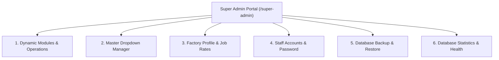

# Akshay RD Jeans - Super Admin Secret Portal Guide

This guide documents the **Super Admin Portal** for the Akshay RD Jeans factory management system.

---

## 🔒 Secret Access & Strict Security (URL Only)

As requested, **NO buttons, links, or navigation items** are displayed anywhere on the standard user interface or staff dashboard.

* **Secret Super Admin URL**: [`http://localhost:3000/super-admin`](http://localhost:3000/super-admin)
* **Secret Login URL**: [`http://localhost:3000/super-admin/login`](http://localhost:3000/super-admin/login)
* *(Note: Any attempt to access `/admin` automatically forwards to `/super-admin`)*.

### 🔑 Super Admin Credentials

| Field | Value |
| :--- | :--- |
| **Username** | `AkshayGohel21` |
| **Password** | `Akshay21` |
| **Role** | `SuperAdmin` |

---

## 🛡️ Core Capabilities & Tabs

---

## 1. 🎛️ Dynamic Module Visibility & Operations

Super Admin has full control to show or hide modules on the main staff dashboard:

### A. Dynamic Module Toggles (12 Modules)
Toggle each module **ON (Show)** or **OFF (Hide)**. When toggled OFF, the card disappears instantly from the user dashboard:
1. **Employees** (`/employees`): Staff directory and salary configuration.
2. **Upad / Advances** (`/upad`): Worker advances and pending deduction tracking.
3. **Seth Clients** (`/seths`): Client accounts, pending garments, and billing.
4. **Hisab Seth** (`/hisab-seth`): Cutting & roll settling calculation slips.
5. **Cutting Entries** (`/cutting`): Production cut registrations and fabric consumption.
6. **Finished Goods** (`/inventory`): Garment ready stock and dispatch.
7. **Roll Inventory** (`/rolls`): Fabric rolls, meters, and status.
8. **Partners** (`/partners`): Partner equity, drawings, and capital.
9. **Income** (`/income`): Revenue inflows and cashbook logging.
10. **Expense** (`/expense`): Production costs, raw materials, overheads.
11. **Cash Book** (`/cashbook`): Unified daily ledger.
12. **Reports** (`/reports`): Financial statements and summaries.

### B. Dynamic Operational Toggles
* **Auto Roll Deduction**: Automatically deduct consumed meters from roll inventory upon saving a cutting entry.
* **Auto Finished Goods Entry**: Automatically register finished garments into inventory when cutting lots are created.
* **Strict Upad Balance Check**: Block salary settlement if worker's outstanding Upad advances exceed total earnings.
* **Lock Settled Records**: Prevent edits or deletions of Cutting, Seth Hisab, and Upad entries once settled.

---

## 2. 🏷️ Dropdown Master (Complete Dynamic Customization)

Super Admin can add, edit, rename, and delete options for every dropdown across the software, as well as create brand-new dropdown categories:

### Default Managed Categories:
1. **Fabric Types**: e.g., `Heavy Indigo Denim 12oz`, `Lycra Denim Stretch`, `Cotton Twill`, `Knit Denim`.
2. **Expense Categories**: e.g., `Thread & Spools`, `Needles`, `Machine Oil`, `Electric Bill`, `Factory Rent`, `Washing Jobwork`.
3. **Income Sources**: e.g., `Job Work Stitching`, `Seth Settlement Billing`, `Fabric Scrap / Chindi Sale`, `Ready Jeans Stock Sales`.
4. **Employee Roles**: e.g., `Master Cutter`, `Stitching Operator`, `Overlock Operator`, `Kaj-Button Operator`, `Iron Master`, `Checker`.
5. **Payment Methods**: e.g., `Cash`, `Google Pay / UPI`, `PhonePe`, `Bank Transfer / NEFT`, `Cheque`.
6. **Jeans Sizes**: e.g., `28`, `30`, `32`, `34`, `36`, `38`, `40`, `42`, `Mix (28-36)`.
7. **Color Shades**: e.g., `Deep Indigo`, `Light Blue`, `Raw Black`, `Ice Wash`, `Grey Slub`, `Vintage Tint`.
8. **Units of Measurement**: e.g., `Meters (m)`, `Pieces (pcs)`, `Rolls`, `Kilograms (kg)`, `Dozen (dz)`.

### Dropdown Actions:
* **Add Item**: Type item name and click **Add** (or press Enter).
* **Inline Rename / Edit**: Click the ✏️ pencil icon next to any item, edit the text inline, and press Enter or the checkmark icon.
* **Delete Item**: Click the ✕ trash icon to remove the item immediately.
* **Create New Category**: Add completely custom dropdown categories on demand with custom keys and display labels.

---

## 3. 🏭 Factory Profile & Operational Rates
* **Factory Details**: Company name, Owner name, Phone number, Factory Address.
* **Default Stitching Rate (₹/pc)**: Pre-fills stitching calculations in Seth Hisab.
* **Default Washing Rate (₹/pc)**: Standard laundry charges per piece.

---

## 4. 👥 Staff Accounts & Super Admin Security
* **Super Admin Password**: Update your `AkshayGohel21` master password securely with live hashing.
* **Staff User Management**: Create, view, update roles (`Admin`, `Manager`, `Cashier`, `Operator`, `Viewer`), or deactivate staff accounts.

---

## 5. 💾 Database Backup & Disaster Recovery
* **Export Full Backup (.json)**: Generates an archive containing all MongoDB collections.
* **Restore from Backup**: Upload a JSON backup to restore factory state.

---

## 6. 📊 Database Statistics & System Health
* Live document counts across all 15 MongoDB collections.
* Database connection status and timestamp verification.
