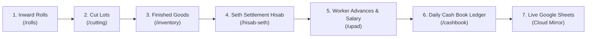

# 👖 Akshay RD Jeans Factory — Client UAT Handover & Testing Guide

---

## 🎯 Is the Product Ready for Client Testing?

**YES, 100% READY!** The system is fully operational, thoroughly tested, and ready for your factory client (owners, managers, cashiers, and cutters) to test end-to-end.

> [!IMPORTANT]
> **Complete Freedom in UAT Testing**:
> * The client can enter **any test, sample, or live factory data** without hesitation.
> * **Zero Risk**: We can reset all test entries back to zero in seconds anytime with `npm run db:clean` before final live production launch.
> * **Automatic Safety**: You can also export a 1-click JSON backup from the Super Admin panel at any time.

---

## 🔑 Login Access for the Client & Owner

| Role | Portal URL | Username | Password | Purpose |
| :--- | :--- | :--- | :--- | :--- |
| **Factory Staff / Manager** | [`http://localhost:3000/login`](http://localhost:3000/login) | `rdjeans123` | `RD@123` | Daily factory operations, cutting, rolls, cashbook, bills |
| **Super Admin (Confidential)** | [`http://localhost:3000/super-admin/login`](http://localhost:3000/super-admin/login) | `AkshayGohel21` | `Akshay21` | Dynamic module show/hide, dropdown master, rates, backups |

*(Note: The regular user dashboard displays **no admin buttons**. The Super Admin portal is accessed strictly by typing the URL).*

---

## 🏭 Step-by-Step Client Testing Walkthrough (7 Core Factory Workflows)

Ask your client to test these 7 daily factory scenarios to experience the software flow:



---

### Workflow 1: Fabric Rolls Receiving ([/rolls](http://localhost:3000/rolls))
* **Goal**: Record incoming denim fabric rolls received from Seth (Trader/Client).
* **Test Steps**:
  1. Go to **Rolls** -> Click **+ Add Roll Entry**.
  2. Select/type Seth name (e.g., `Shreeji Traders`), Roll Number (e.g., `R-101`), Fabric Type (e.g., `Heavy Indigo Denim 12oz`), and Total Meters (e.g., `120.00 m`).
  3. Click **Save Roll**.
* **What to Check**: Roll balance appears as `120.00 m Available` with status `Available`.

---

### Workflow 2: Cutting Entry & Automatic Meter Deduction ([/cutting](http://localhost:3000/cutting))
* **Goal**: Master Cutter registers a cut lot and fabric is automatically deducted.
* **Test Steps**:
  1. Go to **Cutting** -> Click **+ Add Cutting Entry**.
  2. Select Cutter Name (e.g., `Ramesh Cutter`), Roll Number (`R-101`), Lot Number (e.g., `LOT-801`), Pieces Cut (e.g., `85 pcs`), Meters Used (e.g., `102.00 m`), Size (e.g., `32`).
  3. Click **Save Cutting**.
* **What to Check**:
  - The software automatically computes the fabric consumption average: `102 ÷ 85 = 1.20 meters/piece`.
  - Go back to **Rolls**: Notice Roll `R-101` automatically dropped from `120.00 m` to `18.00 m` remaining!

---

### Workflow 3: Garment Tracking & Finished Goods ([/inventory](http://localhost:3000/inventory))
* **Goal**: Track jeans from sewing floor into finished/dispatched stock.
* **Test Steps**:
  1. Go to **Finished Goods**. Lot `LOT-801` is automatically registered with `85 pieces` in stitching!
  2. Update lot: Move `80 pcs` to `Finished / Ready` and `5 pcs` to `Rejected / Alter`.
  3. Enter dispatch details when sending ready cartons to the client.

---

### Workflow 4: Seth Hisab & Jobwork Settlement Slip ([/hisab-seth](http://localhost:3000/hisab-seth))
* **Goal**: Generate complete jobwork billing slip for the Seth client.
* **Test Steps**:
  1. Go to **Hisab Seth** -> Click **+ Create Seth Hisab**.
  2. Select Seth (`Shreeji Traders`).
  3. Select the cutting lots belonging to this Seth (or import them with 1 click).
  4. Enter stitching rate (e.g., `₹55 / piece`) and optional washing/extra charges (e.g., `₹5 / pc`).
  5. The gross total, total fabric used, average per piece, and net balance due are automatically computed!
  6. Click **Print / Export PDF Slip** to view the clean printable settlement bill.
  7. When Seth pays (e.g., `₹4,000 Cash`), record payment -> Balance due updates instantly!

---

### Workflow 5: Worker Upad (Cash Advances) ([/upad](http://localhost:3000/upad))
* **Goal**: Track cash advances given to floor operators and prevent salary overpayment.
* **Test Steps**:
  1. Go to **Upad** -> Click **+ Give Advance**.
  2. Select Worker (e.g., `Suresh Stitching`), Amount (e.g., `₹1,000`), Payment Mode (`Cash`).
  3. Check the worker's summary: Total pending Upad shows `₹1,000`.
  4. Notice `₹1,000` is automatically recorded as an outflow in the **Cash Book**!

---

### Workflow 6: Daily Factory Cash Book ([/cashbook](http://localhost:3000/cashbook))
* **Goal**: Maintain the factory cash register with zero manual double-entry.
* **Test Steps**:
  1. Go to **Cash Book**.
  2. Notice how Upad advances, Seth bill collections, and scrap income flow in automatically.
  3. Click **Excel Export** or **PDF Statement** to download the clean daily factory register.

---

### Workflow 7: Real-Time Google Sheets Cloud Sync ([/google-sheets](http://localhost:3000/google-sheets))
* **Goal**: Cloud backup on Google Drive so the owner never loses data.
* **Test Steps**:
  1. Click **Sheets Sync** in the header.
  2. Click **Sync Entire Factory (All 12 Sheets)**.
  3. Open the linked Google Spreadsheet: Verify all 12 tabs (`Employees`, `Rolls`, `Cutting`, `Finished Goods`, `Seths`, `Seth Hisab`, `Upad`, `Cash Book`, etc.) are filled with navy blue headers!

---

## 🛡️ Super Admin Controls for Owner ([/super-admin](http://localhost:3000/super-admin))

Show your client owner (`AkshayGohel21`) what they can customize without writing code:
1. **Dynamic Show / Hide**: If the factory doesn't use the *Partner* or *Inventory* module right now, turn them **OFF** in Super Admin, and the cards immediately disappear from the staff dashboard!
2. **Dropdown Master**:
   * Add the factory's exact denim fabrics (e.g., *12oz Lycra Denim*, *Black Knit*).
   * Customize factory worker designations (*Overlock*, *Kaj-Button*, *Iron Master*).
   * Customize expense heads (*Chai-Nashta*, *Thread Cones*, *Machine Oil*).
3. **Factory Defaults**: Change standard stitching rate (`₹50`) or washing charges (`₹5`).
4. **Database Backup**: Click **Export Full Backup (.json)** anytime to download the entire factory database.

---

## 🧹 How to Reset Test Data When Going Live to Production

When the client completes testing and says: *"Everything is perfect, now clear the test entries so we can enter real factory data"*:

Simply run this command in terminal:
```bash
npm run db:clean
```

### What `npm run db:clean` does:
* Clears all sample rolls, cutting lots, hisab slips, advances, cashbook entries, and goods.
* Resets ID numbering back to sequence #1 (Lot #1, Roll #1, Bill #1).
* Sets cash balance to ₹0.00.
* **Preserves** all user login accounts (`rdjeans123` and `AkshayGohel21`) and factory settings so the client can start fresh immediately.

---

## 📝 Key Feedback Questions to Ask the Client During UAT

Ask the factory client these questions to gather their feedback:
1. **Stitching & Washing Defaults**: What is your factory's standard stitching rate per piece and washing charge?
2. **Cutting Size Formats**: Do you cut by standard sizes (`28, 30, 32, 34, 36`) or by bundle ratios?
3. **Printed Slip Layout**: Does the Hisab Seth printable settlement bill have all columns your clients expect?
4. **Staff Roles**: How many staff members (cutters, cashiers, managers) need separate logins?
5. **Dashboard Modules**: Are there any modules they don't need on their main screen right now? (You can hide them in Super Admin).
