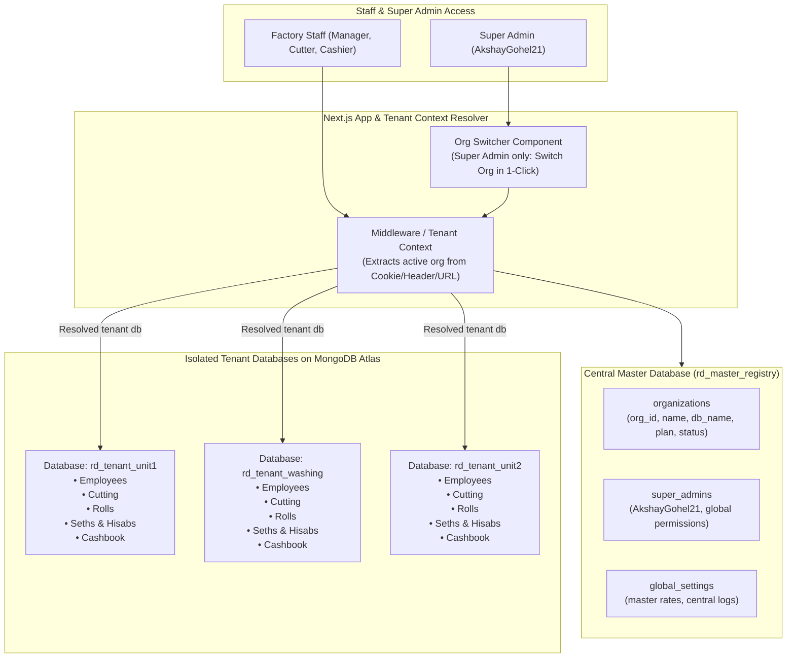
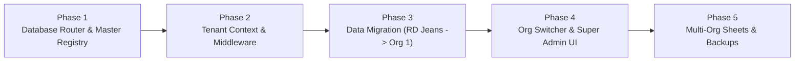

# 🏢 Multi-Organization Architecture & Data Separation Plan
### Akshay RD Jeans Factory ERP — Enterprise Multi-Tenancy Strategy

---

## 📌 Executive Summary

Currently, the software operates as a **single-organization system** dedicated specifically to **"RD Jeans Factory"**. All MongoDB collections (`employees`, `cutting_entries`, `rolls`, `finished_goods`, `seths`, `seth_hisabs`, `upad_records`, `cash_book_ledger`, `incomes`, `expenses`, etc.) store data in a single shared pool without organization boundaries.

To scale the software so you can manage **multiple organizations / factories / units / sister companies** (e.g., *RD Jeans Unit 1*, *RD Washing & Dyeing*, *RD Trading*, or independent client factories) with **100% separate, isolated data**, you need a **Multi-Tenant / Multi-Organization Architecture**.

> [!IMPORTANT]
> **Key Requirement**:
> - RD Jeans is currently 1 organization.
> - Need ability to create **more organizations**, each having **completely separate data**.
> - This document presents the complete architectural plan, database design, and migration strategy without modifying active code.

---

## 🔍 Comparative Analysis: 3 Multi-Organization Approaches

There are three industry-standard patterns for multi-organization architectures in Next.js + MongoDB. Here is how they compare for your factory ERP:

| Feature / Criteria | Option A: Shared DB with `org_id` (Discriminator) | Option B: Database-Per-Tenant (Dedicated DBs) | Option C: Separate Clusters (Multi-Instance) |
| :--- | :--- | :--- | :--- |
| **Data Isolation Level** | Logical (Row-level filter `org_id`) | **Physical (Separate DB per factory)** | Physical (Separate Cloud Clusters) |
| **Data Leak Risk** | Moderate (if a query forgets `org_id`) | **Near Zero (Database boundary)** | Zero |
| **MongoDB Atlas Cost** | Lowest (Single cluster & DB) | **Lowest (Single cluster, many DBs)** | Highest (Multiple paid clusters) |
| **Backup / Export per Org** | Filtered query export | **Instant native single-DB backup** | Separate cluster backup |
| **Cross-Org Super Admin Analytics** | Easiest (Single aggregation query) | Easy (Querying each DB or central analytics) | Complex (Distributed queries) |
| **Migration Effort from Current Code** | Medium (Modify all 15 services) | **Low to Medium (Dynamic DB routing)** | Very High (DevOps overhead) |
| **Suitability for RD Jeans** | Good | **⭐️ RECOMMENDED BEST FIT** | Overkill |

---

## 🏆 Recommended Architecture: Option B ("Database-Per-Tenant with Master Routing")

### Why Option B is Best for RD Jeans Factory:
1. **100% Ironclad Data Isolation**: Factory A (`rd_jeans_unit1`) can never accidentally see or overwrite Factory B (`rd_washing_plant`) data because they live in completely separate MongoDB databases.
2. **Clean Backups & Restores**: If you want to backup or restore *only* Organization B without touching Organization A, you can dump or restore just `rd_factory_org_b` in one click.
3. **No Code Re-writing for Every Single Service Query**:
   - Currently, all your services call `const db = await getMongoDb()`.
   - In Option B, `getMongoDb(orgSlug)` simply connects to `client.db(tenantDbName)`. Existing queries (`db.collection('cutting_entries').find(...)`) do not need an `org_id` field added to every single query and filter!
4. **Super Admin Global Visibility**: A central database (`rd_master_registry`) keeps track of all organizations, their owners, active modules, and Super Admin credentials (`AkshayGohel21`).

---

## 🗺️ High-Level System Architecture Diagram



---

## 🧱 Detailed Schema & Database Structure

### 1. Central Master Database: `rd_master_registry`
This database exists once for the entire system and is managed strictly by the Super Admin.

#### Collection: `organizations`
```json
{
  "_id": "ObjectId('672b1a8f...')",
  "org_id": "org_rd_jeans_unit1",
  "name": "RD Jeans Factory (Unit 1)",
  "slug": "rd-jeans-unit1",
  "database_name": "rd_tenant_unit1",
  "owner_name": "Akshay Gohel",
  "phone": "+91 98765 43210",
  "address": "GIDC Katargam, Surat, Gujarat",
  "gstin": "24AAAAA0000A1Z5",
  "status": "Active",
  "created_at": "2026-11-15T16:30:00.000Z",
  "settings": {
    "default_stitching_rate": 50,
    "default_washing_rate": 5,
    "shift_hours": 10,
    "currency_symbol": "₹",
    "google_sheets_webhook_url": "https://script.google.com/macros/s/.../exec"
  },
  "module_visibility": {
    "employees": true,
    "upad": true,
    "seths": true,
    "hisab_seth": true,
    "cutting": true,
    "finished_goods": true,
    "rolls": true,
    "partners": true,
    "income": true,
    "expense": true,
    "cashbook": true,
    "reports": true
  }
}
```

#### Collection: `users_global`
Stores which users have access to which organizations:
```json
{
  "_id": "ObjectId('...')",
  "username": "AkshayGohel21",
  "role": "SuperAdmin",
  "allowed_organizations": ["*"],
  "default_organization": "rd-jeans-unit1"
}
```
And local staff accounts:
```json
{
  "_id": "ObjectId('...')",
  "username": "cutter_ramesh",
  "role": "Operator",
  "allowed_organizations": ["rd-jeans-unit1"],
  "default_organization": "rd-jeans-unit1"
}
```

---

### 2. Isolated Tenant Databases: `rd_tenant_<org_slug>`
Each organization gets its own database on MongoDB Atlas:
* `rd_tenant_unit1`
* `rd_tenant_washing_plant`
* `rd_tenant_unit2`

Inside each tenant database, **all 15 factory collections exist independently**:
1. `employees` (Staff specific to this unit)
2. `upad_records` (Advances specific to this unit)
3. `seths` (Clients doing business with this unit)
4. `seth_hisabs` (Settlement bills for this unit)
5. `cutting_entries` (Cutting lots for this unit)
6. `finished_goods` (Inventory ready or dispatched from this unit)
7. `rolls` (Fabric warehouse stock of this unit)
8. `partners` (Partners and capital of this unit)
9. `partner_transactions` (Drawings and investments)
10. `incomes` (Receipts of this unit)
11. `expenses` (Overheads of this unit)
12. `cash_book_ledger` (Daily cash balance of this unit)
13. `salaries` (Payroll of this unit)
14. `system_settings` (Dropdown options, rates of this unit)
15. `integration_settings` (Google Sheets sync config for this unit)

---

## 👥 User Roles & Access Hierarchy

```
                                👑 Super Admin (AkshayGohel21)
                                              │
              ┌───────────────────────────────┴───────────────────────────────┐
              ▼                                                               ▼
🏢 Organization 1 (RD Jeans Unit 1)                             🏢 Organization 2 (RD Wash Plant)
  ├── 👤 Org Admin (Factory Manager)                              ├── 👤 Org Admin (Plant Manager)
  ├── 👤 Cashier (Cashbook & Upad)                                ├── 👤 Cashier
  └── 👤 Operators / Cutters (Floor entries)                       └── 👤 Operators
```

### Access Boundaries:
1. **Super Admin (`AkshayGohel21`)**:
   - Master access across all organizations.
   - Header features an **"Active Organization" dropdown**: Akshay can select *RD Jeans Unit 1*, *RD Wash Plant*, etc., and the whole UI immediately switches to that factory's live data.
   - Access to `/super-admin` to create new organizations, edit subscription/status, and configure organization-specific modules.
2. **Organization Admin (e.g. Factory Manager)**:
   - Full control within their assigned organization.
   - Cannot see other organizations or their financial figures.
3. **Staff (Cashier, Operator, Viewer)**:
   - Locked strictly to their assigned organization.

---

## 🖥️ User Experience & UI Walkthrough

### 1. The Global Organization Switcher (Header)
In the top dashboard header, an elegant organization pill appears:
```
[ RD Jeans Unit 1 ▼ ]    [ ☁️ Sheets Sync ]    [ Logout ]
```
When clicked by Super Admin:
* A popover opens showing:
  - 🏢 **RD Jeans Factory (Unit 1)** (Active ✓)
  - 🏢 **RD Washing & Processing Plant**
  - 🏢 **RD Jeans Export Unit 2**
  - ➕ **+ Create New Organization**
* Clicking any organization instantly changes the context cookie (`rd_active_org=rd-tenant-washing`) and reloads the active dashboard without logging out!

### 2. Super Admin Organization Management Tab (`/super-admin`)
Under the Super Admin portal, a new dedicated tab: **"Organizations Management"**:
* **Organization Cards / Grid**:
  - Displays each organization with its logo/emblem, total employees, monthly cutting pieces, and status (`Active`).
  - Action buttons: `Enter Organization`, `Edit Settings`, `Export Backup (.json)`, `Deactivate`.
* **"Create Organization" Wizard**:
  - Step 1: Organization Name, Slug, and Address.
  - Step 2: Owner name and contact number.
  - Step 3: Default stitching & washing rates.
  - Step 4: Choose which of the 12 modules are enabled.
  - Click **Create**: System automatically creates the database on Atlas, seeds default dropdown categories, and makes it available instantly!

---

## 📊 Google Sheets Multi-Organization Strategy

How to handle Google Sheets sync when there are multiple organizations?

### Recommended Strategy: Dedicated Spreadsheet per Organization
* **Why**: Factory managers from Unit 1 should not have access to the Google Sheet of Unit 2.
* **How it works**:
  - When creating Organization B, you paste Organization B's Google Apps Script Webhook URL into its Integration Settings.
  - Syncing Unit 1 writes to `RD Jeans Unit 1 Master Sheet` (12 tabs).
  - Syncing Unit 2 writes to `RD Washing Plant Master Sheet` (12 tabs).
* **Super Admin Consolidated Sheet (Optional)**:
  - A 13th master spreadsheet that pulls high-level summary cards (Daily Net Cash, Total Pieces Cut) across all organizations for high-level management overview.

---

## 🛠️ Step-by-Step 5-Phase Implementation Roadmap

Here is how this can be implemented safely in the future with **zero data loss and zero downtime**:



### Phase 1: Master Database Router (`lib/mongodb.ts`)
* Create `lib/services/tenant-router.ts`.
* Update `getMongoDb(orgSlug?: string)` to dynamically resolve either:
  - The central registry `rd_master_registry` (for Super Admin & Auth).
  - The specific tenant database `rd_tenant_<slug>` based on the active user session.

### Phase 2: Tenant Context & Middleware (`proxy.ts`)
* Add tenant cookie `rd_active_org`.
* Middleware reads `rd_active_org` and passes `x-tenant-org` in request headers to all API routes.
* For regular staff, enforce that `x-tenant-org` strictly matches their authorized organization.

### Phase 3: Seamless Data Migration of Existing Records
* Create a one-time script `scripts/migrate-to-multi-org.mjs`:
  1. Creates central `organizations` entry for **"RD Jeans Factory"** (`slug: "rd-jeans-main"`).
  2. Moves existing collections into `rd_tenant_rd_jeans_main` database.
  3. All existing client entries, cutting lots, rolls, and cash book remain 100% intact.

### Phase 4: Frontend Switcher & Super Admin Management
* Add the **Organization Switcher** dropdown to `components/dashboard-header.tsx`.
* Add the **Organizations Master** tab in `/super-admin` with the Create/Edit/Delete Organization wizard.

### Phase 5: Per-Organization Backup & Google Sheets
* Update `/api/super-admin/backup` to support exporting a specific organization or all organizations.
* Each organization gets its own Google Sheets integration credentials.

---

## 🔒 Security & Data Leak Prevention Safeguards

1. **Strict Context Validation**:
   - An API request without a valid organization context is rejected with `400 Bad Request: Organization context missing`.
2. **Role Boundaries**:
   - Staff credentials (`cutter_ramesh`) are bound to their `allowed_organizations`. Attempting to switch organizations without Super Admin privileges triggers an immediate `403 Forbidden`.
3. **Audit Trail**:
   - Super Admin actions (creating organizations, deleting organizations, switching context) are logged with timestamp and IP address.

---

## 📋 Summary & Strategic Recommendation

| Action | Recommendation |
| :--- | :--- |
| **Recommended Path** | **Option B (Database-Per-Tenant with Master Routing)** |
| **Current Status** | Strategy & Architecture documented; **no code or data altered**. |
| **Next Step for You** | Review this architecture document. When you are ready to begin, we will execute Phase 1 without disturbing your active factory operations. |
