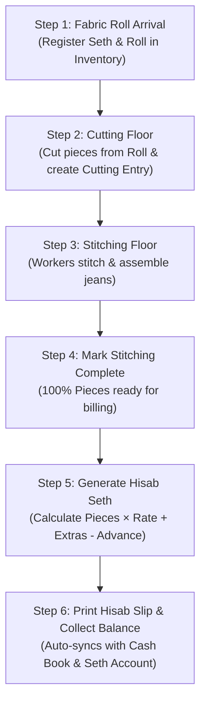

# Akshay RD Jeans - Hisab Seth (Job Work & Settlement) Step-by-Step User Guide

This guide gives complete, step-by-step instructions on how the **Seth Hisab** workflow works in the factory management system—from fabric roll arrival to cutting, stitching completion, billing settlement, and slip printing.

---

## 📌 Workflow Overview

---

## 📋 Step-by-Step Instructions

### Step 1: Add Seth & Fabric Roll (Fabric Arrival)

When a Seth (trader / client) brings fabric rolls to your factory:

1. **Check if Seth is already added:**
   * On the Dashboard, click the **Seth** card (or go to `/seths`).
   * If new Seth, click **`+ Add Seth`**, enter their name (e.g., `Mahavir Seth`), phone number, and address.
2. **Add the Fabric Roll:**
   * Go to Dashboard $\rightarrow$ Click **Roll Inventory** (or go to `/rolls`).
   * Click the **`+ Add Roll`** button at the top right.
   * Fill in:
     * **Seth Client**: Select your Seth (e.g., `Mahavir Seth`).
     * **Roll Number**: Enter the roll number (e.g., `R-101`).
     * **Fabric Type**: Select or enter fabric type (e.g., `Heavy Indigo Denim 12oz`).
     * **Received Meters**: Enter total fabric meter (e.g., `500`).
   * Click **`Save Roll`**.
   * ✅ *Result:* The system now shows `R-101` with `500m Received`, `0m Used`, and `500m Remaining`.

---

### Step 2: Cutting Entry (Cut Pieces from Roll)

When the cutter master lays out the fabric and cuts the jeans parts:

1. Go to Dashboard $\rightarrow$ Click **Cutting** (or go to `/cutting`).
2. Click the **`+ New Cutting Entry`** button.
3. Fill in the cutting details:
   * **Date**: Today's cutting date.
   * **Lot Number**: Enter a lot number (e.g., `LOT-01`).
   * **Select Roll**: Choose the roll cut from (e.g., `R-101 - Mahavir Seth`).
   * **Meters Used**: Enter exact meters cut (e.g., `200`).
   * **Pieces Count**: Enter jeans pieces cut (e.g., `150`).
   * **Size / Ratio**: Enter size (e.g., `30-36`).
   * *(Optional)* Cutter employee name & notes.
4. Click **`Save Cutting Entry`**.
5. ✅ *Result:*
   * Fabric roll `R-101` automatically updates: `200m Used`, `300m Remaining`.
   * Average consumption is calculated: $200\text{ m} \div 150\text{ pcs} = 1.33\text{ m/pc}$.
   * The batch is automatically registered on the sewing floor with status **In Stitching**.

---

### Step 3: Stitching Work & Mark Complete

The bundled parts are distributed to your sewing operators on the floor:

1. Open **Hisab Seth** from the Dashboard (or go to `/hisab-seth`).
2. Select your Seth from the dropdown (or view **All Seths**).
3. Under the **Seth Work & Stitching** tab, you will see `LOT-01` with status 🔵 **In Stitching**.
4. Once your stitching line finishes stitching all 150 pieces:
   * Click the green button **`✓ Complete Stitching`** on that lot card.
   * Confirm the prompt.
5. ✅ *Result:*
   * Status instantly changes to 🟢 **Stitching Complete (Ready for Hisab)**.
   * The lot appears immediately under the **Ready for Hisab** tab.

---

### Step 4: Make "Hisab Seth" (Job Work Settlement & Billing)

Now that stitching is 100% complete, you prepare the job-work account settlement:

1. In **Hisab Seth**, click the **`Make Hisab`** button on the lot card (or the top **`+ New Hisab`** button).
2. The **Generate Seth Hisab** window opens:
   * **Seth Client**: Selected Seth is pre-filled.
   * **Select Cutting Lots**: Tick the checkbox next to `LOT-01` (you can also select multiple completed lots to combine them into one bill).
   * **Job Work / Stitching Rate (₹/pc)**: Enter your stitching rate (e.g., `50`).
     * Live calculation:
       $$\text{Stitching Amount} = 150\text{ pcs} \times ₹50 = ₹7,500$$
   * **Extra Charges (Optional)**: If you did washing, trims, or packaging:
     * Enter amount (e.g., `500`) and note (e.g., `Washing & Thread`).
   * **Deductions (Optional)**: If there is any shortage or fabric defect penalty:
     * Enter amount (e.g., `0`).
   * **Gross Total Bill**: Automatically calculated:
     $$\text{Gross Total} = ₹7,500 + ₹500 - ₹0 = ₹8,000$$
   * **Advance / Paid Now**:
     * If Seth pays on the spot or gave an advance, enter the amount (e.g., `₹3,000`).
     * Choose payment method: `Cash`, `Bank Transfer`, `GPay / UPI`, or `Cheque`.
     * Handled by: `Akshaybhai`.
   * **Net Balance Due**: Shows remaining balance:
     $$\text{Balance Due} = ₹8,000 - ₹3,000 = ₹5,000$$
3. Click **`Save & Generate Hisab`**.
4. ✅ *Result:*
   * A permanent settlement record (`HSB-2026-0001`) is saved.
   * Cutting `LOT-01` is marked as **Settled**.
   * If any payment was entered (`₹3,000`), it is **automatically recorded into Cash Book** as factory income!

---

### Step 5: Print Slip & Collect Balance

1. Immediately after saving, the **Printable Hisab Slip** window opens.
2. Click **`Print Slip`** $\rightarrow$ opens standard print dialog formatted for A4 or thermal receipt printer.
   * Contains:
     * Company Name: **AKSHAY RD JEANS**
     * Bill No (`HSB-2026-0001`) & Date
     * Seth Name & Details
     * Roll No, Fabric Type, Meters Used
     * Lot No, Pieces Cut, Stitched Pieces, Rate (₹), Subtotal
     * Total Pieces & Fabric Average ($1.33\text{ m/pc}$)
     * Extra charges, Deductions, Gross Total, Paid Amount, Balance Due
     * Signature stamp
3. Hand the physical or PDF slip to the Seth.

---

### Step 6: Pay Outstanding Balance (When Seth Pays Later)

When the Seth clears their pending balance (e.g., remaining `₹5,000`):

1. Go to **Hisab Seth** $\rightarrow$ Click the **Hisab Bills & Slips** tab.
2. Find bill `HSB-2026-0001` (marked with amber badge **Partially Paid**).
3. Click the green button **`Pay Balance`**.
4. Enter payment amount (e.g., `5000`), date, payment method, and handled by.
5. Click **`Record Payment`**.
6. ✅ *Result:*
   * Status updates to 🟢 **Paid**.
   * Balance becomes `₹0`.
   * The new `₹5,000` entry is instantly added into **Cash Book Ledger** under Seth Payments.

---

### Step 7: Export & Import Hisab Records (Excel / CSV)

To backup, share, or import bulk hisab data:

1. **Export to Excel (`.xlsx`):**
   * Click **`Export`** at the top right header (or click **`Excel (.xlsx)`** in the *Hisab Bills & Slips* tab).
   * Generates a multi-sheet Excel file:
     * **Sheet 1 (Hisab Statements):** Summary of bills, Seth names, pieces, gross totals, advance paid, and balance due.
     * **Sheet 2 (Cutting Lots Detail):** Per-lot breakdown of roll numbers, meters used, cut pieces, average, and rate.
2. **Export to CSV (`.csv`):**
   * Click **`CSV`** in the *Hisab Bills & Slips* tab for quick export into Google Sheets or external accounting software.
3. **Import Past Hisab Records:**
   * Click the **`Import`** button at the top header.
   * Click **`Template`** to download `seth_hisab_import_template.csv`.
   * Fill your records into the template, choose the file, preview the rows, and click **`Import Now`**.
   * System imports the records and automatically links them to Seths and Cutting lots.

---

## ☁️ Step 7: Real-Time Google Sheets Backup (Zero Data Loss)

To prevent any data loss and maintain a live, off-site cloud ledger simultaneously, Hisab Seth supports **Real-Time Google Sheets Sync**.

### 🔄 How it works:
1. Whenever a Hisab bill is generated or a subsequent balance payment is received, the app immediately sends an asynchronous webhook event to your Google Spreadsheet.
2. It automatically appends or updates the row with the bill number, Seth name, cutting lot count, total meters, pieces, gross amount, advance paid, balance due, and payment status.
3. Both you and your accountant can see live numbers in Google Sheets on mobile or laptop from anywhere!

### 🚀 2-Minute Setup Instructions:
1. Create a blank spreadsheet at [Google Sheets](https://sheets.new).
2. In Google Sheets top menu, click **Extensions** $\rightarrow$ **Apps Script**.
3. In the Hisab Seth screen, click the **`Google Sheets`** button in the header and click **`Copy Script`**.
4. Paste the code into Google Apps Script, click **Save**, then click **Deploy** $\rightarrow$ **New deployment**.
5. Under Select type, choose **Web app**.
6. Under *Who has access*, choose **Anyone** (crucial for webhook to post without complex OAuth).
7. Click **Deploy**, copy the resulting **Web App URL**.
8. Paste the Web App URL into Hisab Seth $\rightarrow$ click **Save Settings**.
9. Click **`Test Connection`** to send a test ping, or **`Sync All Now`** to immediately copy all past records into your spreadsheet!

---

## ⚡ Quick Button Reference Table

| Button / Action | Where to Find It | What It Does |
| :--- | :--- | :--- |
| **`Hisab Seth`** | Dashboard $\rightarrow$ Quick Access | Opens the main Hisab Seth workspace. |
| **`Google Sheets`** | Hisab Seth $\rightarrow$ Top Header | Opens Google Sheets real-time sync configuration and instructions. |
| **`Import`** | Hisab Seth $\rightarrow$ Top Header | Opens modal to upload past hisab records from Excel or CSV. |
| **`Export`** | Hisab Seth $\rightarrow$ Top Header | Downloads all hisab settlement records as a formatted Excel (.xlsx) file. |
| **`Excel (.xlsx)` / `CSV`** | Hisab Bills & Slips tab | One-click export for the currently filtered list of settlement bills. |
| **`Template`** | Import Modal | Downloads ready-to-use sample CSV template with columns pre-configured. |
| **`Sync All Now`** | Google Sheets Modal | Pushes all existing hisab settlements into Google Sheets in one click. |
| **`+ Add Roll`** | Roll Inventory (`/rolls`) | Adds new fabric roll received from Seth. |
| **`+ New Cutting Entry`** | Cutting (`/cutting`) | Cuts fabric from a roll and creates a production lot. |
| **`✓ Complete Stitching`** | Hisab Seth $\rightarrow$ Lot Card | Marks all cut pieces as stitched and ready for billing. |
| **`Make Hisab`** | Hisab Seth $\rightarrow$ Lot Card | Opens the billing window with that lot pre-selected. |
| **`+ New Hisab`** | Hisab Seth $\rightarrow$ Top Right | Opens blank Hisab window to select any Seth and multiple lots. |
| **`Print Slip`** | Hisab Seth $\rightarrow$ Bill Card / Modal | Opens print preview of the formatted settlement invoice. |
| **`Pay Balance`** | Hisab Seth $\rightarrow$ Bill Card | Records payment against unpaid / partial settlement. |
| **`Open Seth Hisab`** | Seth Profile (`/seths/[id]`) | Quick shortcut directly to that specific Seth's Hisab. |

---

## 💡 Practical Real-World Example

* **Seth**: *Suresh Seth*
* **Fabric Roll**: Roll #44, 400 meters received.
* **Cutting**: Cut 180 meters $\rightarrow$ yields 120 pairs of jeans (Lot #22).
* **Sewing**: Workers finish stitching all 120 pieces $\rightarrow$ click `✓ Complete Stitching`.
* **Hisab**:
  * $120\text{ pcs} \times ₹48/\text{pc} = ₹5,760$ stitching charge
  * Washing extra $= ₹600$
  * Gross Total $= ₹6,360$
  * Advance paid in cash $= ₹2,000$
  * Remaining Balance $= ₹4,360$
* **Result**: `HSB-2026-0002` created, ₹2,000 added to Cash Book, and slip printed!
