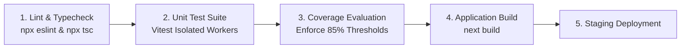

# RD Jeans Test Automation & CI/CD Pipeline Workflow
**Document ID:** `QA-DOC-014-AUTOMATION`  
**System:** RD Jeans Factory Management System  

---

## 1. Automated CI Pipeline Stages

The automated testing pipeline runs sequentially on every branch push and pull request:



---

## 2. GitHub Actions CI Configuration Blueprint

```yaml
name: RD Jeans QA & Test Pipeline

on:
  push:
    branches: [main, develop]
  pull_request:
    branches: [main]

jobs:
  test:
    runs-on: ubuntu-latest
    steps:
      - name: Checkout Code
        uses: actions/checkout@v4

      - name: Setup Node.js Runtime
        uses: actions/setup-node@v4
        with:
          node-version: 22.x
          cache: 'npm'

      - name: Install Dependencies
        run: npm ci

      - name: Static Typecheck
        run: npx tsc --noEmit

      - name: Execute Unit Tests & Generate Coverage
        run: npm run test:coverage

      - name: Upload Coverage Artifacts
        uses: actions/upload-artifact@v4
        with:
          name: coverage-report
          path: coverage/
```
