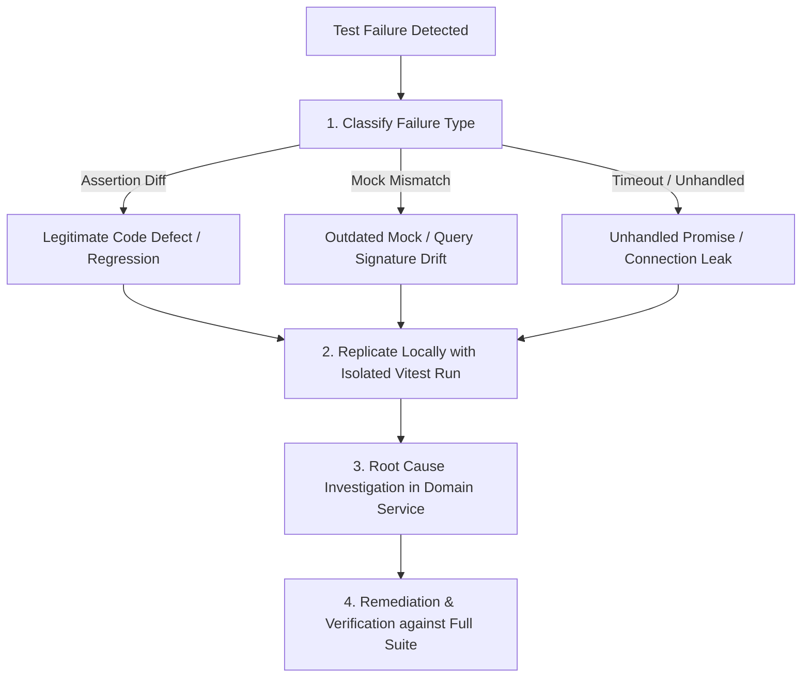

# RD Jeans Failure Analysis & Root Cause Triage Protocol
**Document ID:** `QA-DOC-012-FAILURE-ANALYSIS`  
**System:** RD Jeans Factory Management System  

---

## 1. Triage Workflow

When an automated test fails during development or in a CI pipeline, follow this 4-step triage procedure:

---

## 2. Common Failure Archetypes & Fixes

### Archetype 1: Floating Point Comparison Failure
- **Symptom**: `expected 12000.000000000002 to be 12000`.
- **Root Cause**: Binary floating-point arithmetic on currency calculations.
- **Fix**: Parse values with `Number(val.toFixed(2))` or use `expect(val).toBeCloseTo(12000, 2)`.

### Archetype 2: Unreleased Database Client Connection
- **Symptom**: Vitest hangs or outputs `Jest did not exit one second after the test run has completed`.
- **Root Cause**: `client.release()` omitted in the `finally` block of a transactional service method.
- **Fix**: Ensure all `getClient()` calls wrap execution in `try ... finally { client.release() }`.

### Archetype 3: Outdated SQL Query Mock Signature
- **Symptom**: `Expected mock to have been called with SQL query X, but was called with Y`.
- **Root Cause**: A schema migration or query column update changed query syntax without updating the test expectation.
- **Fix**: Update the mock expectation to match the canonical SQL query.
