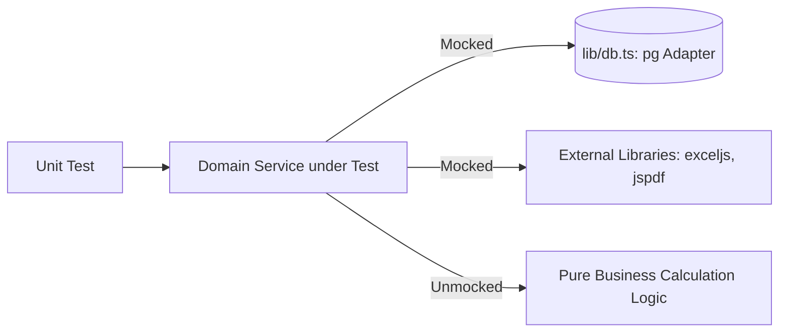

# RD Jeans Mocking Strategy & Isolation Architecture
**Document ID:** `QA-DOC-006-MOCKING`  
**System:** RD Jeans Factory Management System  

---

## 1. Philosophy of Mocking at RD Jeans

To achieve robust, deterministic, and fast tests, mocking must be applied at the **outer boundaries** of our domain logic, while keeping internal business rules unmocked.



### What We Mock:
1. **PostgreSQL Adapter (`lib/db.ts`)**: Network database queries and client connections.
2. **Third-party binary generators (`exceljs`, `jspdf`)**: Heavy binary buffer generators when testing report service logic.
3. **Time / System Clocks**: Use `vi.useFakeTimers()` when testing date-dependent payroll calculations.

### What We NEVER Mock in Unit Tests:
1. **Business Calculations**: Net salary, roll meter balance, layer average, cash running totals must run for real.
2. **Authentication Cryptography (`bcryptjs`, `jsonwebtoken`)**: In unit tests for `lib/auth.ts`, use real cryptographic hashing to guarantee signature and hash compatibility.

---

## 2. Standard Database Mock Implementation Pattern

Create a reusable mock client factory to simulate transactions and queries cleanly:

```typescript
export function createMockDbClient() {
  const queryMock = vi.fn()
  const releaseMock = vi.fn()

  return {
    query: queryMock,
    release: releaseMock,
    // Helper to queue sequential query responses
    queueQueryResponse: (rows: any[] = [], rowCount: number = rows.length) => {
      queryMock.mockResolvedValueOnce({ rows, rowCount })
    },
    queueQueryError: (error: Error) => {
      queryMock.mockRejectedValueOnce(error)
    }
  }
}
```

---

## 3. Transactional Boundary Verification

In methods executing multi-query transactions (`BEGIN` $\rightarrow$ multiple `INSERT`/`UPDATE` $\rightarrow$ `COMMIT` / `ROLLBACK`):
- Ensure `mockClient.query('BEGIN')` was invoked first.
- Ensure `mockClient.query('COMMIT')` was invoked on the happy path.
- In error scenarios, assert that `mockClient.query('ROLLBACK')` was called and `mockClient.release()` was called in the `finally` block to prevent connection leaks.
