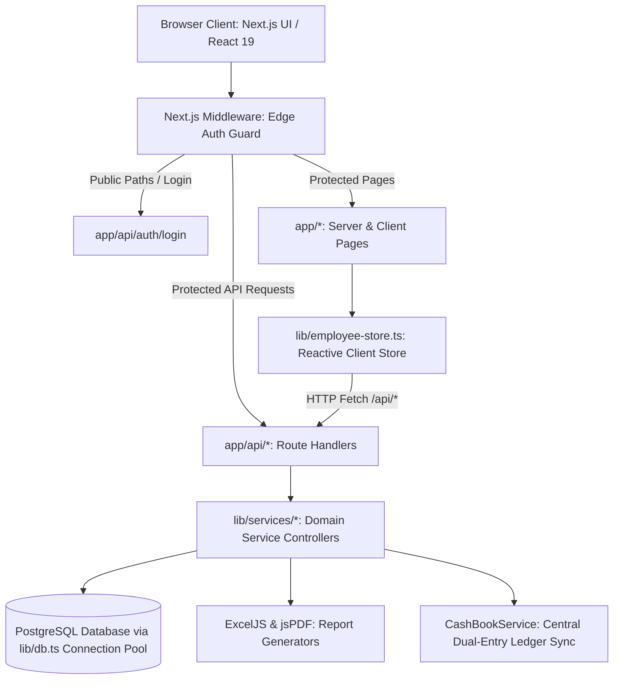
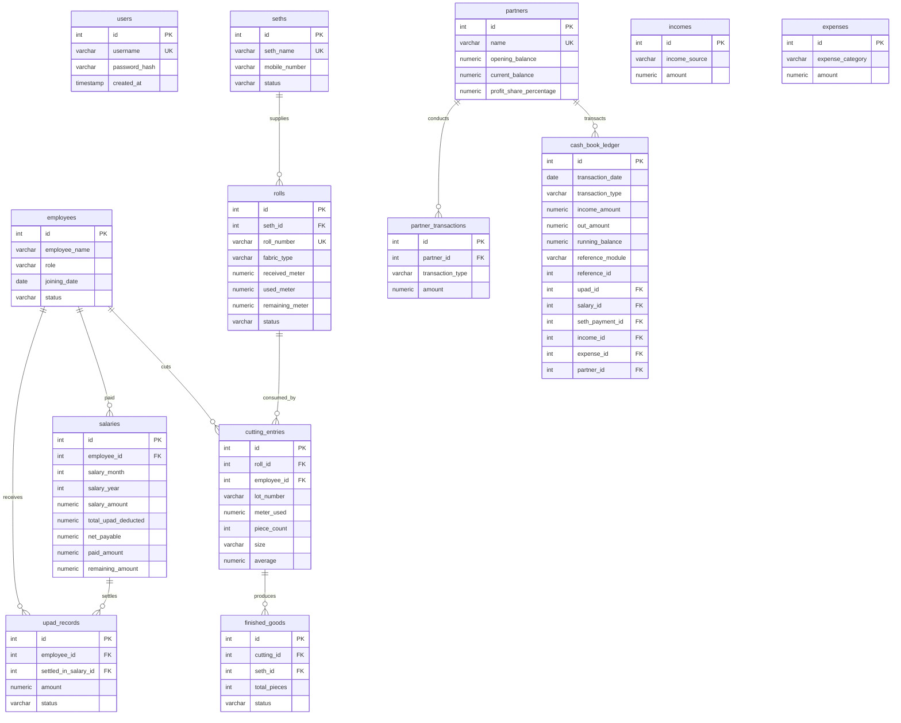

# RD Jeans Factory Management System - Project Discovery & QA Audit
**Document ID:** `QA-DOC-001-DISCOVERY`  
**Phase:** Phase 1 - Complete Project Discovery  
**Author:** Senior QA Automation Engineer & Software Test Architect  
**Date:** October 30, 2026  
**Status:** Approved & Baselined  

---

## 1. Executive Summary

This Project Discovery & QA Audit document establishes the baseline inspection of the **RD Jeans Factory Management System** codebase prior to implementing the automated testing infrastructure. 

The application is an Enterprise Resource Planning (ERP) platform custom-engineered for denim manufacturing operations, raw fabric roll tracking, client ("Seth") job-work management, piece cutting lot calculation, employee registry, weekly advances ("Upad"), monthly salary settlement, operational cashbook ledgers, and co-owner partner equity accounting.

A comprehensive audit of the repository reveals that the system has transitioned from an earlier hybrid prototype (Next.js client + decoupled FastAPI Python backend) to a **unified, full-stack Next.js 16 (App Router) architecture in TypeScript**, utilizing Node-Postgres (`pg`) connection pooling for database operations, direct transactional service controllers, Edge middleware authentication guards, and a reactive client-side store.

Currently, **no automated unit testing framework** is configured in `package.json`. Testing is limited to two ad-hoc Node.js integration/E2E runner scripts that require a live server and database. Zero unit test coverage exists for pure business logic, calculations, and transactional domain services.

---

## 2. Technology Stack & Environment Discovery

| Layer | Discovered Technology | Specification / Version | Role in Architecture |
| :--- | :--- | :--- | :--- |
| **Runtime** | Node.js | v25.9.0 (Verified via CLI) | JavaScript/TypeScript Server & Tooling Runtime |
| **Package Manager** | npm | v11.12.1 (pnpm & lockfiles present) | Dependency management & script orchestration |
| **Language** | TypeScript / JavaScript | TypeScript 5.7.3, ESNext modules | Full-stack static typing across UI, API, and Services |
| **Full-Stack Framework** | Next.js (App Router) | 16.2.6 (React 19.0.0, react-dom 19.0.0) | Unified server-rendered pages and API route handlers |
| **Database Engine** | PostgreSQL | PostgreSQL 15+ / Cloud PG (Supabase/Neon) | Relational persistence, transactional ACID guarantees |
| **Database Client** | `pg` (node-postgres) | ^8.22.0 (`@types/pg` ^8.21.0) | Connection pooling (`Pool`), parameterization, transactions |
| **Styling & UI Engine** | Tailwind CSS v4 + Shadcn UI | `@tailwindcss/postcss` ^4.2.0, `@base-ui/react` ^1.5.0 | Utility styling, design tokens, responsive layout |
| **Authentication / Security**| `jose` + `jsonwebtoken` + `bcryptjs` | `jose` (Edge runtime), `jsonwebtoken` ^9.0.3, `bcryptjs` ^3.0.3 | JWT generation/verification, bcrypt password hashing |
| **Document Processing**| `exceljs`, `jspdf`, `jspdf-autotable` | `exceljs` ^4.4.0, `jspdf` ^4.2.1, `jspdf-autotable` ^5.0.9 | Excel spreadsheet & PDF audit report generation |
| **Data Validation** | `zod` | ^4.4.3 | Schema validation for payloads and form inputs |
| **Icons & Visuals** | `lucide-react` | ^1.16.0 | Operational UI iconography |

---

## 3. Application Architecture & Data Flow

### 3.1 Architectural Evolution & Current State
The project history shows an evolutionary consolidation:
1. **Legacy Architecture (Superseded)**: Decoupled Python FastAPI backend (`backend/app/*` with SQLAlchemy ORM) queried by Next.js via HTTP (`localhost:8000`). All FastAPI modules have been staged for deletion.
2. **Current Architecture (Active Baseline)**: Fully unified Next.js App Router application in TypeScript. Route handlers (`app/api/*`) directly invoke modular domain service controllers (`lib/services/*`) which execute parameterized SQL queries via connection pooling (`lib/db.ts`).

### 3.2 High-Level Architecture Diagram



### 3.3 Data Flow & Transactional Sync Pattern
A core design pattern throughout the backend services is the **Dual-Entry Synchronized Cash Ledger Pattern**:
- Every operational action with financial implications (Upad issuance, Monthly Salary disbursement, External Seth payment, Factory expense, Revenue income, Partner capital deposit or drawing) automatically triggers an entry in `cash_book_ledger`.
- The `CashBookService` maintains a running balance using an atomic SQL window function:
  $$\text{Running Balance}_i = \sum_{k=1}^i (\text{Income}_k - \text{Out}_k)$$
- When historical entries are updated or deleted, `recalculateBalancesFrom(startId)` recalculates running balances for all downstream transactions.

---

## 4. Source Directory & Module Inventory

```
d:\Akshay RD jeans\
├── app/                                 # Next.js App Router Pages and API Handlers
│   ├── api/                             # Backend REST Route Handlers (36 Endpoints)
│   │   ├── auth/login/                  # POST: Authentication & JWT issuance
│   │   ├── cashbook/                    # GET, POST, summary: Central Ledger management
│   │   ├── cutting/                     # GET, POST, [id]: Fabric piece-cutting lots
│   │   ├── dashboard/                   # GET: Aggregated factory KPI metrics
│   │   ├── employees/                   # GET, POST, [id]: Worker master registry
│   │   ├── expenses/                    # GET, POST, [id]: Factory operational overheads
│   │   ├── finished-goods/              # GET, POST, [id], summary: Garment inventory & dispatch
│   │   ├── health/                      # GET: DB connectivity and uptime check
│   │   ├── income/                      # GET, POST, [id]: Revenue and payment inflows
│   │   ├── partners/                    # GET, POST, [name], all, summary, transactions: Dual-owner equity
│   │   ├── reports/                     # GET, export, export/excel, export/pdf: Reporting center
│   │   ├── rolls/                       # GET, POST, [id]: Raw denim fabric roll inventory
│   │   ├── salary/                      # GET, POST, [id], employee/[id]/summary: Payroll & settlements
│   │   ├── seths/                       # GET, POST, [id], [id]/payments: Client job-work directory
│   │   └── upad/                        # GET, POST, [id], employee/[id]/summary: Worker advance slips
│   ├── cashbook/                        # UI: Ledger passbook view and entry modal
│   ├── cutting/                         # UI: Cutting log and yield management
│   ├── employees/                       # UI: Worker directory and status toggles
│   ├── expense/                         # UI: Categorized expense tracker
│   ├── income/                          # UI: Revenue tracking
│   ├── inventory/                       # UI: Fabric roll and inventory management
│   ├── login/                           # UI: Admin authentication view
│   ├── partners/                        # UI: Partner capital and passbook view
│   ├── reports/                         # UI: Report generator and filter interface
│   ├── rolls/                           # UI: Roll intake and status overview
│   ├── salary/                          # UI: Monthly salary calculator and settlement
│   ├── seths/                           # UI: Client directory and ledger
│   ├── upad/                            # UI: Worker cash advances view
│   ├── layout.tsx                       # Root UI layout and theme wrapper
│   └── page.tsx                         # Primary dashboard executive view
├── components/                          # React 19 UI Components
│   ├── auth-provider.tsx                # Client authentication context & persistence
│   ├── cash-balance-card.tsx            # Live cash balance metric display
│   ├── dashboard-header.tsx             # Global application header with date & auth status
│   ├── factory-summary.tsx              # Grid of top-level factory KPI cards
│   ├── quick-access.tsx                 # Fast navigation shortcuts to operational modules
│   ├── recent-activities.tsx            # Live stream of recent cash transactions
│   └── ui/button.tsx                    # Reusable button primitive with CVA variants
├── lib/                                 # Shared Backend Core & Domain Services
│   ├── api.ts                           # Client HTTP wrapper with JWT token injection
│   ├── auth.ts                          # JWT signing, verification, and bcrypt hashing
│   ├── dashboard-data.ts                # Static module configuration and UI schemas
│   ├── db.ts                            # PostgreSQL connection pool (`Pool`) & query helper
│   ├── employee-store.ts                # Reactive client state management (1,721 lines)
│   ├── utils.ts                         # Tailwind CSS merge utility (`cn`)
│   └── services/                        # Domain Business Logic Services (13 Services)
│       ├── cashbook.ts                  # Cashbook ledger, balance calculation, foreign key sync
│       ├── cutting.ts                   # Cutting lots, layer calculations, roll meter deduction
│       ├── dashboard.ts                 # Aggregated metrics for dashboard KPI display
│       ├── employees.ts                 # Employee CRUD and role filtering
│       ├── expenses.ts                  # Expense categorisation and cashbook sync
│       ├── finished-goods.ts            # Production stages, dispatch, piece counts
│       ├── income.ts                    # Revenue capture and cashbook sync
│       ├── partners.ts                  # Owner capital, drawings, equity calculation
│       ├── reports.ts                   # Export queries, CSV formatting, ExcelJS, jsPDF
│       ├── rolls.ts                     # Roll registry, meter tracking, state transitions
│       ├── salary.ts                    # Salary calculation, Upad deduction, partial payout
│       ├── seths.ts                     # Seth directory and payment logging
│       └── upad.ts                      # Upad advance records, status transitions, salary settlement
├── middleware.ts                        # Edge Middleware: JWT token verification & route guard
├── scripts/                             # Utility & Database Scripts
│   ├── migrations/                      # SQL schema migration files (001 to 005)
│   ├── run-migration.mjs                # Node migration runner script
│   ├── run-all-tests.mjs                # Ad-hoc integration script (live server required)
│   └── senior-audit-e2e.mjs             # Ad-hoc E2E script (live server required)
├── docs/                                # Technical & Architectural Documentation
└── package.json                         # Project manifest & dependency declarations
```

---

## 5. Database Schema & Relational Model

PostgreSQL stores all application state across 14 relational tables:



---

## 6. Authentication & Security Architecture

1. **Authentication Mechanism**:
   - Administrative login at `/api/auth/login` accepts `username` and `password`.
   - `lib/auth.ts` verifies password against `users.password_hash` using strict `bcrypt.compare`.
   - On successful authentication, generates a JSON Web Token (JWT) signed with `SECRET_KEY` (or `JWT_SECRET`) using `HS256`, expiring in 30 minutes.
   - Sets secure HTTP cookie `rd_token` and returns token in response payload.
2. **Authorization & Route Interception**:
   - `middleware.ts` runs on all incoming requests (excluding static assets `_next/*`, `favicon.ico`, `.png`, etc.).
   - Exempts `/api/auth/login` and `/api/health`.
   - For all other `/api/*` routes, extracts JWT from `Authorization: Bearer <token>` header or `rd_token` cookie.
   - Decodes token via `jose.jwtVerify`. If invalid or expired, immediately aborts with `HTTP 401 Unauthorized` (`detail: "Unauthorized: Access token is missing, invalid, or expired."`).
   - Injects authenticated user headers (`x-user-name`, `x-user-id`) for downstream route handlers.
   - For browser page visits, unauthenticated users are redirected to `/login`.

---

## 7. Critical Business Operations & Edge Cases

The following operations carry direct financial, operational, or legal risk and represent high-priority unit testing targets:

| Operation | Domain Service | Critical Invariants & Rules | Risk if Defective |
| :--- | :--- | :--- | :--- |
| **Running Cash Balance Recalculation** | `CashBookService` | Running balance must satisfy: $B_i = B_{i-1} + \text{In}_i - \text{Out}_i$ across all historical and current ledger entries. Updates to historical rows must cascade running balance changes to all subsequent rows. | Cash discrepancy between factory safe and books, audit failure. |
| **Roll Consumption & State Transition** | `CuttingService`, `RollService` | When cutting lot is recorded, roll `used_meter` increases by `meter_used`, `remaining_meter` decreases. Status transitions: `remaining_meter == received_meter` $\rightarrow$ `Available`; `0 < remaining_meter < received_meter` $\rightarrow$ `Partially Used`; `remaining_meter <= 0` $\rightarrow$ `Completed`. A lot cannot consume more meters than remain on the roll. | Phantom inventory, fabric stockouts, material loss. |
| **Salary Settlement with Upad Deduction** | `SalaryService`, `UpadService` | Net payable = $\text{Base Salary} - \text{Total Upad Deducted}$. Remaining amount = $\text{Net Payable} - \text{Paid Amount}$. Settled Upads must transition status from `Pending` to `Settled` and link to `salary_id`. Settled Upad records cannot be edited or deleted. Outflow logged to Cashbook must equal `paid_amount`. | Double-counting advances, paying workers incorrect amounts, labor disputes. |
| **Upad Issuance & Cashbook Sync** | `UpadService`, `CashBookService` | Creating an Upad record must atomically create a corresponding Cashbook outflow entry with `reference_module = 'upad'` and `reference_id = upad.id`. Updating amount must update cashbook outflow and recalculate running balance. | Cash leakage, unrecorded worker loans. |
| **Dual-Owner Partner Equity Accounting** | `PartnerService` | Equity Balance = $\text{Opening Balance} + \sum \text{Investments} + \sum \text{Profits} - \sum \text{Drawings}$. Cash handling = $\sum \text{Cash In Handled} - \sum \text{Cash Out Handled}$. Inward/outward movements must balance between Rajubhai and Dhruveshbhai. | Disputes between co-owners, inaccurate capital statements. |
| **Report Generation & Formatting** | `ReportService` | CSV exports must follow RFC 4180. Excel exports (`exceljs`) must produce valid XLSX buffers with styled headers. PDF exports (`jspdf`) must format tables without truncation. Category filtering must be SQL-injection safe. | Inability to provide tax/audit records, corrupted data exports. |

---

## 8. Current Testing Status & Gap Analysis

### 8.1 Existing Test Scripts Inspection
The repository currently contains two custom test scripts in `scripts/`:
1. `scripts/run-all-tests.mjs`:
   - Checks presence of 14 PostgreSQL tables.
   - Checks 5 foreign key constraints.
   - Executes HTTP calls to `http://localhost:3000/api/employees` and `/api/auth/login`.
   - **Limitations**: Requires a running Next.js web server on port 3000 and live PostgreSQL connection. Does not run in CI/CD without full server provisioning. Provides no coverage report.
2. `scripts/senior-audit-e2e.mjs`:
   - End-to-end audit scenario executing login, worker creation, upad issuance, cutting lot entry, salary payout, partner capital transaction, and cashbook balance verification.
   - **Limitations**: Heavyweight integration test requiring live server; slow execution; does not test unit-level edge cases or failure modes.

### 8.2 Modules Without Test Coverage (100% Uncovered)
The following modules currently have **0% automated unit test coverage**:
1. `lib/services/cashbook.ts` (0 tests)
2. `lib/services/cutting.ts` (0 tests)
3. `lib/services/salary.ts` (0 tests)
4. `lib/services/upad.ts` (0 tests)
5. `lib/services/rolls.ts` (0 tests)
6. `lib/services/partners.ts` (0 tests)
7. `lib/services/employees.ts` (0 tests)
8. `lib/services/expenses.ts` (0 tests)
9. `lib/services/income.ts` (0 tests)
10. `lib/services/seths.ts` (0 tests)
11. `lib/services/finished-goods.ts` (0 tests)
12. `lib/services/reports.ts` (0 tests)
13. `lib/services/dashboard.ts` (0 tests)
14. `lib/auth.ts` (password hashing, verification, token encoding/decoding: 0 unit tests)
15. `lib/utils.ts` (styling helper: 0 unit tests)
16. `lib/api.ts` (URL normalizer, token injector: 0 unit tests)
17. `middleware.ts` (Edge guard, public path bypass, token rejection: 0 unit tests)
18. `components/ui/button.tsx` & visual components (0 unit tests)

---

## 9. Test Architecture & Tooling Selection

Based on the actual project architecture (TypeScript 5.7, Node 25, React 19, Next.js 16 App Router, ES Modules), the optimal unit testing and QA stack is determined as follows:

### 9.1 Recommended Tooling
1. **Test Runner & Assertion Framework: Vitest**
   - **Rationale**: Built-in native TypeScript and ESM support without complex Babel/ts-jest transforms. Extremely fast execution with isolated worker threads. Built-in mocking utilities (`vi.mock`, `vi.fn`, `vi.spyOn`). Compatible with Jest API syntax. Native support for Node.js environment.
2. **Coverage Engine: `@vitest/coverage-v8`**
   - **Rationale**: High-performance V8 native code coverage reporting with statement, branch, function, and line coverage metrics. Generates standard LCOV, text summary, and HTML reports.
3. **Mocking & Isolation Strategy**:
   - Database operations in `lib/db.ts` (`query`, `pool`, `getClient`) will be mocked at the adapter level to test all domain service logic, transactions, error handling, calculations, and rollbacks without requiring a live PostgreSQL instance for unit tests.
   - Pure mathematical calculations (salary settlement, net payable, roll meter deduction, running balances) will be tested against pure unit test suites with boundary and edge case inputs.

---

## 10. Next Phase Deliverables (Phase 2 Preview)

With Project Discovery complete and verified against the live filesystem:
1. **Phase 2**: Complete Testing Infrastructure Setup (`vitest.config.ts`, coverage thresholds, npm test scripts, mock utilities).
2. **Phase 3**: Comprehensive Unit Test Implementation across all 13 domain services, authentication utilities, and helper modules.
3. **Phase 4**: Test Execution, Failure Resolution, and Coverage Verification.
4. **Phase 5**: Final QA Audit Report & Testing Documentation (`docs/testing/QA_AUDIT_REPORT.md`).
