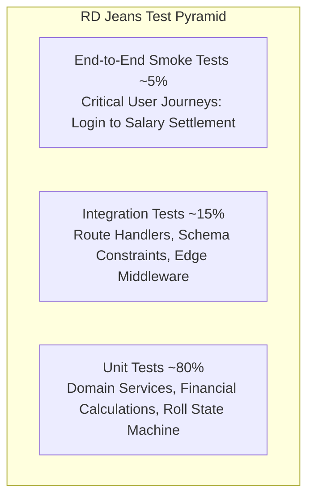

# RD Jeans Testing Strategy & Quality Assurance Framework
**Document ID:** `QA-DOC-002-STRATEGY`  
**Standard:** ISO/IEC/IEEE 29119 Software Testing Standards  
**System:** RD Jeans Factory Management System  

---

## 1. Quality Mission & Philosophy

The primary objective of the testing strategy is to guarantee **financial consistency, inventory precision, and operational reliability** across the RD Jeans ERP platform. 

In garment manufacturing, small discrepancies in fabric meters or wage settlements compound into significant operational losses. Consequently, our testing strategy prioritizes pure unit test verification of business algorithms and transactional integrity over brittle, slow end-to-end tests.

---

## 2. The RD Jeans Testing Pyramid

### 2.1 Tier 1: Unit Testing (80% of Suite)
- **Target Scope**: Pure logic in `lib/services/*`, `lib/auth.ts`, `lib/utils.ts`.
- **Characteristics**: Sub-second execution, zero network or database dependencies, completely mocked `lib/db.ts`.
- **Key Assertions**:
  - Running balance monotonicity in `CashBookService`.
  - Upad deduction from base salary in `SalaryService`.
  - Roll meter consumption and status transitions in `CuttingService` and `RollService`.
  - Partner equity calculations in `PartnerService`.

### 2.2 Tier 2: Integration Testing (15% of Suite)
- **Target Scope**: Route handlers in `app/api/*`, `middleware.ts`, transactional database boundaries.
- **Characteristics**: Verifies HTTP status codes, JSON payload formatting, authentication token injection, and multi-query transaction commit/rollback behavior.

### 2.3 Tier 3: End-to-End Verification (5% of Suite)
- **Target Scope**: Multi-step business workflows covering end-to-end data lifecycle:
  - Worker creation $\rightarrow$ Upad issuance $\rightarrow$ Month-end salary settlement $\rightarrow$ Cashbook ledger audit.
  - Roll inward $\rightarrow$ Multiple cutting lots $\rightarrow$ Finished goods status update $\rightarrow$ Inventory exhaustion.

---

## 3. Test Prioritization Matrix (Risk-Based Testing)

| Priority | Module | Business Risk | Failure Impact | Test Frequency |
| :---: | :--- | :--- | :--- | :--- |
| **P0 (Critical)** | `CashBookService` | Financial balance corruption | Discrepancy in factory cash drawer | Every commit & PR |
| **P0 (Critical)** | `SalaryService` & `UpadService` | Incorrect wage payments | Worker labor strikes / cash loss | Every commit & PR |
| **P0 (Critical)** | `CuttingService` & `RollService` | Fabric meter miscalculation | Fabric shrinkage & undetected theft | Every commit & PR |
| **P1 (High)** | `Auth` & `Middleware` | Unauthorized access | Breach of factory financial ledgers | Every commit & PR |
| **P1 (High)** | `PartnerService` | Misallocated partner capital | Co-owner equity dispute | Every PR |
| **P2 (Medium)** | `Reports` (`exceljs`, `jspdf`) | Malformed exports | Inability to audit transactions | Nightly / Pre-release |
| **P2 (Medium)** | `FinishedGoodsService` | Incorrect piece counts | Dispatch count mismatch with Seth | Every PR |
| **P3 (Normal)** | `DashboardService` | Metric display stale | Non-critical executive view lag | Pre-release |

---

## 4. Definition of Done (DoD) for Testing

A feature, bug fix, or service modification is considered complete and production-ready only when:
1. **Unit Tests Written**: All public methods of the modified service have unit test coverage.
2. **Edge Cases Covered**: Zero, negative, null, boundary, and overflow cases are verified.
3. **Coverage Standard Met**: Code coverage for the service exceeds 90% lines and 85% branches.
4. **All Tests Pass**: 100% of unit tests pass with zero flakiness in isolated worker threads.
5. **No Regressions**: Full test suite passes without breaking existing behavioral contracts.
